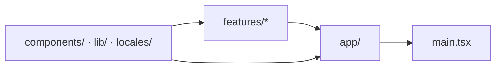

# Features in AUME2026 integrieren

Diese Anleitung richtet sich an die Feature-Teams. Sie beschreibt, wo neuer Code hingehört, wie er die vorhandene Anmeldung und Rechteprüfung nutzt und was vor der Integration geprüft werden muss.

Die Einrichtung unter Windows, macOS und Linux sowie die Startbefehle stehen in der [README](README.md). Für die lokale Entwicklung JDK 21, Node.js 24 und das Backend-Profil `dev` verwenden.

## 1. Den fachlichen Schnitt festlegen

Ein Feature umfasst den Weg von der Oberfläche über die API bis zur Speicherung und Rechteprüfung. Vor der Umsetzung mit dem zuständigen PO die Akzeptanzkriterien und mit dem Lead Developer den technischen Ansatz klären. Dazu gehören:

- Welche der drei Sichten nutzt die Funktion: Studierende, Objektbetreuung oder Sachbearbeitung?
- Welche Aktionen sind erlaubt, und auf welche Wohnanlage beziehungsweise WG sind sie begrenzt?
- Welche Daten, Schnittstellen und Features anderer Teams werden benötigt?
- Welche Erfolgs-, Fehler- und Zugriffsfälle müssen nachweisbar funktionieren?

Die [Definition of Ready und Definition of Done](docs/anforderungen/qualitaet/qualitaetszenarien-definition-of-ready-done.md) und die [Rollenvereinbarung](docs/projekt/rollen_arbeitsvereinbarungen/README.md) bilden dafür die Grundlage. Fachliche Annahmen und Abhängigkeiten in der Story festhalten.

## 2. Feature-Branch und Zusammenarbeit

Im Sprint 1 zweigen Feature-Branches zunächst vom Branch `develop` ab und werden per Merge Request wieder nach `develop` gemergt. `staging` und `main` werden vorerst nicht genutzt. Das [Prozessmodell](docs/projekt/prozessmodell/Prozessmodell.md) beschreibt darüber hinaus Release-Branches und einen Weg nach `main`; dieser Weg gilt im Sprint 1 nicht.

Auf `develop` einen kurzlebigen Feature-Branch anlegen. Das Prozessmodell sieht das Muster `<Gruppenkürzel>/<Feature-Bezeichnung>` vor, zum Beispiel:

```bash
git switch develop
git switch -c gruppe_1/kontrollplanung
```

Änderungen in fachlich zusammenhängenden Commits halten und früh einen Merge Request nach `develop` für Feedback öffnen. Gemeinsame Dateien wie `App.tsx`, `SecurityData.java`, `SecurityConfig.java`, Abhängigkeiten und Infrastruktur mit betroffenen Teams abstimmen. Neue Funktionen möglichst in eigenen Dateien und Fachpaketen ergänzen. Änderungen über einen geprüften Merge Request integrieren.

## 3. Orientierung im Grundgerüst

| Bereich | Vorhandene Aufgabe | Einstieg für ein Feature |
| --- | --- | --- |
| `backend/src/main/java/de/seezeit/aume/` | Spring-Boot-Anwendung und Fachpakete | Neues Fachpaket unterhalb dieses Basispakets |
| `backend/.../auth/` | Anmeldung, aktueller Nutzer, gemeinsame Authority-Abbildung | Bestehende Authentifizierung nutzen |
| `backend/.../user/` | Nutzer, Rollen, Privilegien und Startdaten | Benötigte Berechtigungen und Beispieldaten ergänzen |
| `backend/.../residence/` | Wohnanlagen, DTO-Endpunkt mit Zugriff auf die eigene Wohnanlage | Beispiel für eine fachlich begrenzte Abfrage |
| `backend/.../api/config/OpenApiConfig.java` | Gemeinsame OpenAPI-Metadaten und Authentifizierungsschema | API-Vertrag prüfen; gemeinsame Metadaten nur bei Bedarf ändern |
| `backend/src/test/java/de/seezeit/aume/` | Backend- und Sicherheitstests | Tests im zum Fachpaket passenden Testpaket |
| `frontend/src/app/` | App-Komponente, Router, gemeinsames Layout und Fehlerseiten | Feature-Routen und Navigation registrieren |
| `frontend/src/features/` | Ein Ordner je Feature mit Seiten, API-Funktionen und Routen | Neues Feature anlegen; keine Imports aus anderen Features |
| `frontend/src/lib/auth/` | Gemeinsamer API-Zugriff, Sitzung, React-Kontext, Seitenguards und Rückkehr nach Login | `api()`, `useAuth()`, `protectedLoader()` und gemeinsame Antwortprüfung nutzen |
| `frontend/src/components/`, `frontend/src/lib/` | Von mehreren Features genutzte Komponenten und Helfer | Erst hierher verschieben, wenn ein zweites Feature es braucht |
| `infrastructure/` | Compose-Konfiguration und Umgebungsvariablen-Vorlage | Neue Dienste oder Konfiguration bei Bedarf ergänzen |
| `docs/` | Anforderungen, Architektur und Teamprozess | Feature und relevante Entscheidungen dokumentieren |
| `docs/architektur/` | Vollständige Dokumentation der Anwendung | Bei Änderungen am Anwendungscode die betroffenen Dateien anpassen |

`backend/.../` steht in der Tabelle für `backend/src/main/java/de/seezeit/aume/`.

Das Backend folgt dem akzeptierten [ADR-0003 zum modularen Monolithen](docs/architektur/adr/0003-structure-the-backend-as-a-modular-monolith.md). Aktuell sind nur wenige Fachpakete umgesetzt. Neue Pakete nach fachlicher Zuständigkeit schneiden, beispielsweise `inspection` für Kontrollen. Ein Modul stellt anderen Modulen eine gezielte Service-Schnittstelle bereit. Änderungen an fremden Moduldaten erfolgen über diese Schnittstelle; keine direkten Schreibzugriffe auf deren Repositories.

## 4. Backend-Funktion ergänzen

Als Beispiel dient im Folgenden eine neue Kontrollübersicht. Paket `inspection`, Endpunkt `/api/inspections` und Privileg `INSPECTION_READ` sind **Beispiele für eine Erweiterung und noch nicht vorhanden**.

Eine mögliche Aufteilung innerhalb des neuen Fachpakets:

```text
inspection/
  InspectionEntity.java
  InspectionRepository.java
  InspectionService.java
  InspectionController.java
  InspectionView.java
```

Die Aufteilung an den Umfang anpassen. Der vorhandene `ResidenceController` enthält für seinen kleinen Lesefall die Abfrage direkt; bei Geschäftsregeln oder mehreren Aktionen diese in einen Service verschieben.

### Daten und Geschäftsregeln

- JPA-Entities bilden die gespeicherten Fachdaten ab; Repositories kapseln die Datenbankabfragen.
- Eingaben und Antworten als eigene DTOs modellieren. JPA-Entities und ihre Beziehungen nicht unmittelbar als API-Antwort ausgeben.
- Geschäftsregeln und zusammengehörige Schreiboperationen im Service abbilden. Die Transaktion muss auch die Prüfung der Zuständigkeit und die Änderung umfassen.
- Lesende Services mit `@Transactional(readOnly = true)`, schreibende mit `@Transactional` versehen. Bei `open-in-view: false` benötigte Beziehungen innerhalb der Transaktion laden und dort in DTOs umwandeln.
- Pflichtfelder, Wertebereiche, erlaubte Zustandswechsel und widersprüchliche Daten serverseitig prüfen. Falls Bean Validation mit `@Valid` und Jakarta-Constraints eingeführt wird, auch die benötigte Validation-Abhängigkeit im Backend ergänzen; sie ist derzeit nicht explizit eingerichtet.

### API-Vertrag und Rechteprüfung

Neue Endpunkte unter `/api` anlegen. Listen wie beim [ResidenceController](backend/src/main/java/de/seezeit/aume/residence/ResidenceController.java) paginieren: `Pageable` entgegennehmen, DTOs abbilden und `PagedModel` mit `content` und `page` zurückgeben. Das vorhandene Limit liegt bei 100 Einträgen pro Seite.

Eine Aktionsberechtigung mit Method Security prüfen, beispielsweise:

```java
@PreAuthorize("hasAuthority('INSPECTION_READ')")
```

Das ist eine Annotation für die neue Controller- oder Service-Methode, keine vollständige Implementierung. Für ein neues Feature unter `/api/**` ist normalerweise keine neue Filterkette nötig: Die vorhandene [SecurityConfig](backend/src/main/java/de/seezeit/aume/auth/SecurityConfig.java) fordert dort bereits eine Anmeldung. Die fachliche Berechtigung muss das Feature zusätzlich prüfen.

Den aktuellen Nutzer aus dem verifizierten `Principal` ermitteln, wie im bestehenden Wohnanlagen-Endpunkt:

```java
var user = users.requireUser(principal.getName());
```

`users` ist dabei ein per Konstruktor injizierter `AppUserService`. Nutzerkennungen aus Request-Headern oder dem Request-Body ersetzen diesen Principal nicht.

**Die Berechtigung für eine Aktion ersetzt nicht die Prüfung des konkreten Datensatzes.** Eine Kontrolle muss zur erlaubten Wohnanlage beziehungsweise WG gehören. Abfragen möglichst bereits auf den zugänglichen Datenbereich einschränken. Auch bei Detail-, Änderungs-, Lösch- und Export-Endpunkten verhindern, dass fremde IDs den Zugriff erweitern. Bei Neuanlagen Zuordnungen serverseitig bestimmen oder prüfen. Das aktuelle Nutzermodell enthält eine Wohnanlage; WG-Mitgliedschaften und zeitliche Gültigkeiten sind noch nicht implementiert und müssen bei entsprechenden Features ergänzt werden.

HTTP-Verhalten im API-Vertrag festlegen: beispielsweise `400` für ungültige Eingaben, `401` für fehlende Anmeldung, `403` für fehlende Rechte, `404` für nicht zugängliche beziehungsweise nicht vorhandene Ressourcen und `409` für fachliche Konflikte. Die vereinbarten Fälle in Tests absichern. Neue Endpunkte in der generierten [Swagger UI](http://localhost:8080/swagger-ui.html) prüfen; DTOs, Parameter und relevante Antworten bei Bedarf mit OpenAPI-Annotationen erläutern.

Repositories bleiben interne Persistenzschnittstellen. Spring Data REST ist im Grundgerüst nicht aktiv; neue Repositories nicht als unkontrollierte CRUD-API veröffentlichen.

## 5. Rollen, Privilegien und Entwicklungsdaten erweitern

Nutzer haben mehrere Rollen. Die Rollen `STUDENT`, `CARETAKER` und `CLERK` bündeln Berechtigungen. `AppUserService` bildet Rollen und Privilegien auf Spring-Security-Authorities ab (`ROLE_STUDENT` für Rollen, zum Beispiel `GREETING_READ` für Berechtigungen). Die drei Mock-Nutzer verwenden dieselbe Abbildung wie die Keycloak-Anmeldung. Die Startdaten sind wiederholbar, vorhandene Rollenzuweisungen werden nicht überschrieben. Rollen und Berechtigungen werden ausschließlich serverseitig zugewiesen. Es gibt keine öffentliche Nutzerregistrierung oder Rollenverwaltung. Die Mock-Nutzer und ihre Startberechtigungen stehen in der [README](README.md#mock-anmeldung-und-testdaten).

`GET /api/me` liefert das angemeldete Nutzerprofil mit `roles` und `privileges`. Die bisherigen Nutzer- und Repository-Suchendpunkte sind entfernt. Wohnanlagen werden auf die Zuordnung des angemeldeten Nutzers begrenzt: Die Sachbearbeitung über `staff_assignments` (`kind = CLERK`, mehrere Anlagen möglich), alle anderen Sichten noch über die eine Wohnanlage in `users.residence_id`. WG-Mitgliedschaft und zeitliche Zugriffsregeln folgen mit den betreffenden Domänenmodulen.

Im `dev`-Profil ist `POST /api/auth/dev-login` mit `{"userKey":"student"}` (alternativ `caretaker` oder `clerk`) verfügbar. Vor jedem schreibenden Aufruf wird über `GET /api/auth/csrf` ein Token geladen und unter dem zurückgegebenen `headerName` mitgesendet. Cookies müssen erhalten bleiben. `POST /api/auth/logout` beendet die Sitzung. Der Header `X-Dev-User` authentifiziert nicht mehr. Änderungen an Berechtigungen werden für bestehende Entwicklungssitzungen nach erneuter Anmeldung wirksam.

Für die beispielhafte Kontrollübersicht:

1. Mit dem PO festlegen, welche Rollen Kontrollen sehen dürfen und auf welche Daten der Zugriff begrenzt ist.
2. In [SecurityData.java](backend/src/main/java/de/seezeit/aume/user/SecurityData.java) das Privileg `INSPECTION_READ` über den vorhandenen Helfer `privilege(...)` anlegen.
3. Die bereits vorhandenen `role(...)`-Aufrufe der berechtigten Rollen um dieses Privileg ergänzen. Bestehende Berechtigungen beibehalten. Keinen zweiten Aufruf für dieselbe Rolle hinter den ersten setzen.
4. Controller beziehungsweise Service mit `hasAuthority('INSPECTION_READ')` schützen und die Datenzuständigkeit prüfen.
5. In [SampleData.java](backend/src/main/java/de/seezeit/aume/SampleData.java) oder einem eigenen, ebenfalls auf `dev` begrenzten Seeder synthetische Fachdaten ergänzen. Benötigte Rollen und Nutzer müssen zuvor angelegt sein; die Reihenfolge der vorhandenen Seeder berücksichtigen.
6. Backend neu starten und Mock-Nutzer erneut anmelden. Erlaubte und verbotene Fälle prüfen.

**Besonderheit der Seeder:** `SecurityData.role(...)` erstellt nur fehlende Rollen. Bei bereits vorhandenen Rollen werden geänderte Privilegien-Sets nicht übernommen. In der derzeitigen H2-Datenbank mit `ddl-auto: create-drop` wirkt die geänderte Startzuordnung nach einem Backend-Neustart, weil die Datenbank neu aufgebaut wird. Für eine dauerhaft gespeicherte Datenbank braucht eine solche Änderung einen gezielten Datenänderungs- oder Migrationsschritt. Die Zuordnungen nicht bei jedem Start pauschal überschreiben.

Die drei Mock-Nutzer `student`, `caretaker` und `clerk` für die gemeinsame Entwicklungsbasis erhalten. Ihr Login ist auf genau diese Kennungen beschränkt; ein zusätzlich gespeicherter Nutzer bekommt dadurch noch keine Mock-Anmeldung. Weitere Zugriffskonstellationen lassen sich gezielt in Tests aufbauen. Keine echten Personen- oder Zugangsdaten als Beispieldaten einchecken.

Für ein Feature keine eigene Anmeldung, Token-Verarbeitung oder globale Abschaltung von CSRF einführen. Außerhalb von `dev` wird die Identität über Keycloak verifiziert; Anwendungsrollen bleiben in der Datenbank. Änderungen an diesem Zusammenspiel betreffen die gemeinsame Architektur.

### Keycloak außerhalb von `dev`

Ohne `dev`-Profil sind Mock-Anmeldung und Mock-Daten deaktiviert. Das Backend akzeptiert dann ausschließlich Keycloak-Bearer-Token; das Frontend verwendet den Keycloak-Adapter mit Authorization Code und PKCE. `GET /api/auth/config` liefert die öffentlichen Anmeldeeinstellungen. Folgende Umgebungsvariablen sind erforderlich:

| Variable | Beispiel |
| --- | --- |
| `KEYCLOAK_URL` | `https://identity.example.org` |
| `KEYCLOAK_REALM` | `seezeit` |
| `KEYCLOAK_CLIENT_ID` | `seezeit-frontend` |
| `KEYCLOAK_ISSUER_URI` | `https://identity.example.org/realms/seezeit` |
| `KEYCLOAK_AUDIENCE` | `seezeit-api` |

Der Keycloak-Client muss öffentlich sein (ohne Client-Secret), Standard Flow und PKCE unterstützen sowie passende Redirect-, Logout- und Web-Origin-Adressen für das Frontend erlauben. Der Login-Callback verwendet `/login?returnTo=...`; beispielsweise kann eine auf den konkreten Origin begrenzte Redirect-URI `https://app.example.org/login*` freigegeben werden. Weitere Details stehen in der [Routing-Anleitung](frontend/ROUTING.md#anmeldung-und-rückkehr-zur-angeforderten-seite). Ein Audience-Mapper muss `seezeit-api` in die Access-Token aufnehmen. Der Issuer samt Discovery- und JWKS-Endpunkten muss vom Backend erreichbar sein. Signatur, Issuer, Audience und Gültigkeitszeit werden geprüft.

Ein verifiziertes Token wird über `(identity_issuer, identity_subject)` einem bereits angelegten Anwendungsnutzer zugeordnet. Diese Zuordnung und die Rollen müssen durch einen vertrauenswürdigen Provisionierungsprozess gesetzt werden; unbekannte Identitäten erhalten keinen Zugriff. Token-Rollen werden nicht als Anwendungsberechtigungen übernommen. Ein Provisionierungswerkzeug und ein betriebener Keycloak sind nicht Teil dieses Templates. Die bestehende H2-/`create-drop`-Konfiguration bleibt für das Template erhalten; dauerhafte Speicherung und Migrationen müssen vor einem echten Betrieb eingerichtet werden. ADR-0006 bleibt ein Vorschlag.

Für diesen Start nur `infrastructure/compose.yaml` verwenden und die Variablen mit `--env-file infrastructure/.env` laden:

```bash
docker compose -f infrastructure/compose.yaml --env-file infrastructure/.env up --build
```

Der Docker-Start mit Mock-Nutzern steht in der [README](README.md#start-mit-docker).

## 6. Frontend anbinden

Das Frontend verwendet React Router im Data Mode. Die vollständige Anleitung mit Routen-, Loader- und Navigationsbeispielen steht in [frontend/ROUTING.md](frontend/ROUTING.md). Als umgesetzte Referenz dient `frontend/src/features/residences/`.

React Router verwaltet `/login`, die geschützte Übersicht `/`, die Wohnanlagen-Seite `/residences`, `/forbidden` und eine Ansicht für unbekannte URLs. Anmeldung und Navigation berücksichtigen die aktuellen Privilegien. Beim direkten Aufruf einer geschützten Seite wird das Ziel einschließlich Query und Fragment über die Anmeldung hinweg erhalten. Der vorhandene Nginx-SPA-Fallback unterstützt direkte Links und Neuladen im Docker-Frontend. Kontrollseiten sind noch nicht implementiert.

Nach der Anmeldung öffnet sich die Übersicht unter `/`. Studierende sehen dort den Gruß von `GET /api/greeting`. Objektbetreuung und Sachbearbeitung öffnen über die Navigation `/residences`; diese Seite lädt die zugewiesenen Wohnanlagen von `GET /api/residences`. Listen sind paginiert (`?page=0&size=20`) und enthalten `content` und `page`. Die API-Beschreibung steht unter http://localhost:8080/swagger-ui.html.

Neue Features bündeln Seiten, Typen, API-Funktionen und ein eigenes Routen-Array unter `frontend/src/features/<feature>/`. Das Array in `app/router.ts` innerhalb der geschützten `RequireAuth`-Gruppe ergänzen. Einen optionalen Menüeintrag in `app/navigation.ts` registrieren; Labels und Seitentexte in beiden Sprachdateien anlegen. `app/App.tsx` verbindet nur Authentifizierungs- und Router-Provider.

### Ordner unter `frontend/src/`

Die Struktur folgt verbreiteten Empfehlungen für React mit Vite und React Router und ist nur so weit eingeführt, wie es der heutige Umfang braucht. Für React gibt es keine verbindliche Ordnerstruktur. Die frühere [React-Dokumentation](https://legacy.reactjs.org/docs/faq-structure.html) empfiehlt, einfach zu beginnen und erst bei Bedarf auszubauen.

| Quelle | Übernommene Aussage |
| --- | --- |
| [Robin Wieruch: React Folder Structure](https://www.robinwieruch.de/react-folder-structure/) | Struktur mit dem Projekt wachsen lassen. Feature-Ordner für fachlichen Code, technische Ordner nur für wirklich gemeinsamen Code. Code fließt in eine Richtung. Etwas wandert in die gemeinsame Ebene, wenn ein zweites Feature es braucht. Ordnerübergreifende Imports über einen Alias. |
| [Bulletproof React: Project Structure](https://github.com/alan2207/bulletproof-react/blob/master/docs/project-structure.md) | `app/`, `features/`, `components/` und `lib/`. Gerichtete Abhängigkeiten, durch ESLint erzwungen. Keine Barrel-Dateien (`index.ts` mit Re-Exports), weil sie das Tree-Shaking in Vite verschlechtern. Unterordner in einem Feature nur anlegen, wenn sie gebraucht werden. |
| [React Router: Data Mode](https://reactrouter.com/start/data/route-object) | Routen als Objekte mit `loader`, `Component` und `ErrorBoundary`. Jedes Feature exportiert seine Routen; `app/router.ts` setzt sie zusammen. |
| [Feature-Sliced Design](https://feature-sliced.design/) | Geprüft und nicht übernommen. Die sieben Schichten wären für dieses Frontend zu schwer. Die gerichteten Schichten stecken bereits in der gewählten Struktur. |

Ordner wie `hooks/`, `stores/`, `types/`, `utils/` oder `config/` werden erst angelegt, wenn tatsächlich Code dafür existiert.

```text
frontend/src/
  main.tsx                    Einstiegspunkt: Sprache und Keycloak initialisieren, Router erstellen
  index.css                   Globale Basisstile
  app/                        Anwendungsebene: setzt Features und gemeinsamen Code zusammen
    App.tsx                   AuthProvider und RouterProvider verbinden
    App.css                   Stile des Anwendungsrahmens
    App.test.tsx              Routing-Integrationstests über alle Routen
    router.ts                 Routen aller Features registrieren
    navigation.ts             Navigationspunkte zusammenführen
    AppLayout.tsx             Kopfbereich, Navigation, Sprachwahl, Abmelden, Outlet
    RouteErrorLayout.tsx      Layout für Ladefehler
    RequireAuth.tsx           Anmeldung für die geschützte Routengruppe verlangen
    routes/                   Seiten ohne eigenes Feature: Forbidden, NotFound, RouteError
  features/                   Fachliche Features, je ein Ordner
    auth/                     Anmeldeseite und Login-Route
    dashboard/                Übersicht: Seite, API-Funktion, Routen
    residences/               Wohnanlagen: Seite, API-Funktion, Routen, Navigationspunkt
  components/                 Von mehreren Features genutzte React-Komponenten
    LoadingPage.tsx
  lib/                        Gemeinsame, vorkonfigurierte Infrastruktur
    auth/                     Keycloak/Dev-Login, api(), Sitzung, useAuth(), Loader- und Seitenguards
    errors.ts                 UiError und errorKey()
    i18n.ts                   i18next-Instanz und Sprachauswahl
    i18next.d.ts              Typisierung der Übersetzungsschlüssel
  locales/                    de.json und en.json
  assets/                     Statische Dateien (Bilder, Icons)
```

`app/` kennt alle Features und verbindet sie. Hier liegt nur Code, der die Anwendung zusammensetzt. Fachliche Logik gehört in ein Feature. `app/routes/` enthält die Seiten der Anwendung selbst: keine Berechtigung, Seite nicht gefunden und die Fehlerseite für fehlgeschlagene Loader. `RequireAuth.tsx` bleibt in `app/`, weil nur der Router es verwendet. `RequirePrivilege.tsx` liegt in `lib/auth/`, weil Features es in ihren Routen benötigen. `App.test.tsx` liegt neben `App.tsx`, weil es die zusammengesetzte Anwendung mit allen Routen testet.

Ein Feature ist ein fachlich zusammenhängender Ausschnitt, typischerweise eine oder mehrere Seiten unter einem gemeinsamen URL-Pfad. Es heißt wie sein fachlicher Bereich und sein URL-Pfad, also `residences` für `/residences`. Es beginnt flach:

```text
features/residences/
  ResidencesPage.tsx    Seite (liest Loader-Daten)
  api.ts                API-Funktionen und Antworttypen
  routes.tsx            exportiertes RouteObject-Array und optional ein Navigationspunkt
```

Unterordner kommen erst hinzu, wenn das Feature wächst, zum Beispiel `components/` oder `hooks/` für Code, den nur dieses Feature nutzt. `features/auth/` enthält nur die Anmeldeoberfläche. Keycloak, Sitzung und `useAuth()` liegen in `lib/auth/`, weil alle Features sie nutzen. Läge diese Logik im Feature `auth`, müsste jedes andere Feature verboten daraus importieren.

`components/` enthält React-Komponenten, die mindestens zwei Features oder ein Feature und `app/` verwenden. Sie sind fachlich neutral, kennen keine Wohnanlagen oder Kontrollen und rufen keine Fach-APIs auf. Aktuell liegt dort `LoadingPage`.

`lib/` enthält vorkonfigurierte Bibliotheken und anwendungsweite Infrastruktur: Anmeldung und `api()` in `lib/auth/client.ts`, Sitzung und `useAuth()`, `protectedLoader()`, `RequirePrivilege`, `requireOk()` und `returnTo`, außerdem `UiError` und die i18next-Instanz. Ein separates `utils/` entsteht erst für allgemeine, bibliotheksunabhängige Hilfsfunktionen.

`locales/` bleibt auf oberster Ebene, weil jedes Feature dort Texte ergänzt. `assets/` enthält statische Dateien, die über Imports gebündelt werden.

| Neuer Code | Ablage |
| --- | --- |
| Neue Fachseite oder neuer fachlicher Bereich | `features/<bereich>/` mit `routes.ts(x)`; in `app/router.ts` registrieren |
| Komponente, Hook, Typ oder Helfer nur für ein Feature | In diesem Feature, bei Bedarf in `components/` oder `hooks/` |
| Komponente, die ein zweites Feature ebenfalls braucht | Nach `components/` verschieben |
| Hook, Helfer oder Bibliothekskonfiguration für mehrere Features | Nach `lib/` verschieben; bei reinen Hilfsfunktionen `utils/` anlegen |
| Gemeinsamer Hook ohne Bibliotheksbezug | `hooks/` anlegen |
| Seite ohne fachlichen Bereich | `app/routes/` |
| Layout, Provider, Routenregistrierung | `app/` |
| Texte | `locales/de.json` und `locales/en.json` |

Wird gemeinsamer Code nur noch von einem Feature benutzt, wandert er zurück in dieses Feature.

### Abhängigkeiten und Imports



Ein Pfeil bedeutet „darf importiert werden von“.

1. Gemeinsamer Code (`components/`, `lib/`) importiert weder aus `features/` noch aus `app/`.
2. Features importieren aus `components/`, `lib/` und `locales/`, nicht aus `app/` und nicht aus anderen Features. Was zwei Features brauchen, liegt in `components/` oder `lib/`. Wenn zwei Features auf einer Seite zusammenspielen, geschieht das in `app/`.
3. `app/` darf alles importieren und setzt die Features zusammen.

`npm run lint` prüft die ersten beiden Regeln über `no-restricted-imports` in [frontend/eslint.config.js](frontend/eslint.config.js). Ein Import wie `@/app/navigation` aus einem Feature bricht den Lint-Lauf ab. Wenn ein Feature-Ordner gelöscht wird, dürfen nur `app/router.ts` und gegebenenfalls `app/navigation.ts` Fehler melden.

Ordnerübergreifende Imports nutzen den Alias `@/`, der auf `src/` zeigt, zum Beispiel `import { api } from '@/lib/auth/client'`. Der Alias steht in `tsconfig.app.json`; Vite und Vitest übernehmen ihn. Innerhalb eines Features oder Ordners bleibt der Import relativ, zum Beispiel `import { listResidences } from './api'`. Es gibt keine `index.ts`, die einen Ordner re-exportiert. Imports zeigen auf die Datei. Barrel-Dateien erschweren das Tree-Shaking in Vite; die Feature-Grenze prüft ESLint.

Komponenten-Dateien heißen in PascalCase wie die Komponente (`ResidencesPage.tsx`), andere Module in camelCase (`returnTo.ts`, `api.ts`, `routes.tsx`). Feature-Ordner sind kleingeschrieben. Tests liegen als `*.test.ts(x)` neben dem getesteten Code. Kebab-case und Feature-Namen im Singular sind in den Quellen üblich, hier aber nicht eingeführt; das Projekt bleibt bei der bestehenden Schreibweise.

Bewusst nicht eingeführt sind leere technische Ordner, `index.ts` als öffentliche API je Feature, `domains/`, `packages/` und ein Monorepo. Diese Stufen wären für die aktuelle Größe Mehraufwand.

Die Struktur ersetzt eine frühere Mischung: Features importierten aus `app/` und `pages/`, gemeinsamer Code lag lose unter `src/`, und neben `auth.ts` existierte ein Ordner `auth/`. Das Laufzeitverhalten blieb unverändert. Verschoben wurden Dateien und Imports, und die Login-Route wird als `authRoutes` aus dem Feature exportiert.

| Vorher | Nachher | Grund |
| --- | --- | --- |
| `src/App.tsx`, `App.css`, `App.test.tsx` | `src/app/` | Anwendungsebene |
| `src/auth.ts` | `src/lib/auth/client.ts` | Gemeinsame Infrastruktur; Namenskonflikt mit dem Ordner `auth/` aufgelöst |
| `src/auth/*` | `src/lib/auth/*` | Wird von allen Features genutzt |
| `src/app/loaders.ts`, `src/app/RequirePrivilege.tsx` | `src/lib/auth/` | Features importierten aus `app/` |
| `src/errors.ts`, `src/i18n.ts`, `src/i18n.test.ts`, `src/i18next.d.ts` | `src/lib/` | Gemeinsame Infrastruktur |
| `src/pages/LoadingPage.tsx` | `src/components/` | Von Features und App genutzt |
| `src/pages/LoginPage.tsx` | `src/features/auth/` mit `routes.ts` | Fachliche Seite |
| `src/pages/ForbiddenPage.tsx`, `NotFoundPage.tsx`, `RouteErrorPage.tsx` | `src/app/routes/` | Seiten der Anwendung ohne eigenes Feature |
| Relative Imports über Ordnergrenzen | Alias `@/` | Lesbare, verschiebungsstabile Imports |
| – | ESLint `no-restricted-imports` | Abhängigkeitsrichtung wird geprüft |

Für geschützte Datenabfragen `protectedLoader()` aus `lib/auth/loaders.ts` verwenden. Die Seite zusätzlich mit `RequirePrivilege` schützen, falls sie ein Privileg benötigt. Parent- und Child-Loader können parallel laufen; ein Seitenguard allein verhindert deshalb keine unberechtigte Datenabfrage. Der Loader muss seine Sitzung und Berechtigung vor dem API-Aufruf prüfen. Die Navigation wird anhand von Privilegien gefiltert. Die verbindliche Autorisierung und Prüfung konkreter Datensätze bleibt im Backend.

API-Funktionen verwenden den gemeinsamen Helfer `api()` aus `src/lib/auth/client.ts` und prüfen Antworten mit `requireOk()` aus `src/lib/auth/response.ts`. Dadurch werden `401`, `403` und übersetzbare Fehler einheitlich behandelt. Relative `/api/...`-URLs und das `request.signal` des Loaders verwenden. DTO-Typen müssen zum Backend-Vertrag passen; TypeScript-Casts validieren keine Antwortdaten. Neue schreibende Actions müssen ihre Rechte selbst prüfen; der Schutz des Leseloaders reicht dafür nicht aus.

Die aktuelle Sitzung kommt aus `useAuth()`; neue Seiten laden keinen eigenen Anmeldestatus. `RequireAuth` erhält den angeforderten Pfad für die Rückkehr nach der Anmeldung. `Link`, `NavLink` und Router-Navigation statt vollständiger Browser-Neuladungen für interne Seiten verwenden. Für Filter und Pagination `useSearchParams()` nutzen. Die Wohnanlagen-Seite zeigt die Verwendung von `useLoaderData()` und paginierten Daten.

Ladezustand, leere Ergebnisse, Fehler und fehlende Rechte darstellen. Das gemeinsame Layout bietet Navigation, Sprachwahl, Logout und Ladeanzeige. Nach dem Sprachwechsel werden aktuelle Loader revalidiert. Zusätzliche Abfragen außerhalb der Loader müssen diesen Wechsel selbst behandeln. Beschriftungen, Tastaturbedienung und verständliche Rückmeldungen bei der Umsetzung mitprüfen.

### Texte und Lokalisierung

Alle neuen Bedientexte, Beschriftungen, Ladezustände und Meldungen in `frontend/src/locales/de.json` und `frontend/src/locales/en.json` ergänzen. Fachliche Schlüssel nach Funktion gruppieren. In Komponenten `useTranslation()` aus `react-i18next` verwenden und beispielsweise `t('auth.login')` aufrufen. Die deutschen Schlüssel werden über `src/lib/i18next.d.ts` für TypeScript typisiert; keine Schlüssel mit Typ-Casts an der Prüfung vorbeiführen.

Dynamische Werte über benannte Platzhalter einsetzen, beispielsweise einen neuen Text `"created": "Kontrolle {{id}} wurde angelegt."` mit `t('inspections.created', { id })`. Den Schlüssel vorher in beiden Sprachen ergänzen. Sätze nicht aus übersetzten Fragmenten zusammensetzen. Für Mengen die i18next-Pluralformen (`_one`, `_other`) mit `count` verwenden; Datums- und Zahlenwerte mit `Intl.DateTimeFormat` beziehungsweise `Intl.NumberFormat` und der aktuellen Sprache formatieren. Die fachlich maßgebliche Zeitzone gesondert festlegen.

Fehlerzustände als Schlüssel halten, damit bereits sichtbare Meldungen beim Sprachwechsel mitwechseln. Für API-Funktionen und andere Helfer `UiError` aus `src/lib/errors.ts` verwenden; `errorKey(...)` ordnet unbekannte Fehler einem kontrollierten Fallback zu. Technische Fehlermeldungen oder Stacktraces nicht direkt als UI-Text anzeigen. Bei zusätzlichen Fehlern einen Eintrag unter `errors` in beiden JSON-Dateien anlegen.

Die Oberfläche unterstützt Deutsch und Englisch. Über die Sprachauswahl im Kopfbereich lässt sich die Sprache ohne erneute Anmeldung wechseln. Die gemeinsame Initialisierung in `src/lib/i18n.ts` verwenden. Gespeicherte Auswahl (`localStorage`, Schlüssel `aume.language`) hat Vorrang vor der ersten unterstützten Browsersprache; ohne passende Sprache wird Deutsch verwendet. Regionale Angaben wie `en-US` werden auf `en` abgebildet. Bei gesperrtem Browserspeicher funktioniert die Auswahl für die aktuelle Sitzung weiter. Die Initialisierung setzt das HTML-Attribut `lang`. Fehlende englische Texte fallen auf Deutsch zurück. Die Übersetzungen werden mit der Anwendung gebündelt und benötigen keinen externen Übersetzungsdienst. Komponenten sollen keine eigene Spracherkennung oder Speicherung einführen. Die Namen der Sprachen werden in der Auswahl als Eigenbezeichnungen (`Deutsch`, `English`) angezeigt.

Das Backend bekommt die Sprache über `Accept-Language` vom gemeinsamen `api()`-Helfer. Für vom Server formulierte Texte die vorhandene `MessageSource` und die auf Deutsch/Englisch begrenzte `LocaleConfig` nutzen. Deutsche Standardtexte stehen in `messages.properties`, englische in `messages_en.properties`. Beispiel ist der Gruß unter `/api/greeting`; Parameter werden dort über `{0}`, `{1}` eingesetzt, unabhängig von der `{{name}}`-Syntax des Frontends. Sprachabhängige Antworten mit `Content-Language` kennzeichnen. Ohne unterstützte Anforderung ist die Antwort deutsch, unabhängig von der Sprache des Servers. Technische API-Fehlerantworten sind kein Übersetzungsvertrag; die Oberfläche zeigt eigene übersetzte Meldungen an. Maschinenlesbare IDs, Statuswerte, Authorities und gespeicherte Nutzerdaten bleiben sprachunabhängig. Neue Fachfehler möglichst über stabile Fehlercodes an die Oberfläche übergeben, die sie in ihre eigenen Texte übersetzt.

Der aktuelle Sprachwechsel revalidiert die aktiven Routen und lädt damit auch den lokalisierten Gruß neu. Neue serverseitig lokalisierte Ansichten sollen ihre Daten über Routen-Loader beziehen; zusätzliche Abfragen und Caches außerhalb der Loader müssen die Sprache selbst berücksichtigen. Neue Sprachen erfordern zusätzlich die Ressourcen, unterstützten Sprachen und Auswahl im Frontend sowie bei Backend-Texten die Locale-Konfiguration und Message-Bundles.

Bei neuen Texten die Schlüssel in beiden Sprachen sowie Platzhalter und Pluralformen prüfen. Mindestens einen relevanten Sprachwechsel in den Feature-Tests und im Browser berücksichtigen. Namen, Wohnanlagen und andere Fachdaten werden nicht automatisch übersetzt. Für Keycloak wird die gewählte Sprache beim Anmelden mitgegeben; die verfügbaren Sprachen und Anmeldetexte müssen im Keycloak-Realm ebenfalls eingerichtet werden.

## 7. Datenbank und Konfiguration

Der Ordner `infrastructure/` bündelt den späteren Betrieb des Gesamtsystems. Dort liegt kein Quellcode von Frontend oder Backend.

- `compose.yaml` startet Frontend und Backend über die Dockerfiles in `frontend/` und `backend/`. Weitere Dienste kommen später dazu.
- `.env.example` ist die Vorlage für lokale Umgebungsvariablen. Echte Werte kommen in eine `.env`, die nicht eingecheckt wird.
- Die Dockerfiles liegen in `frontend/` und `backend/`. Jedes Image wird aus seinem eigenen Projekt gebaut. Compose verweist darauf.

Der lokale Docker-Start mit dem `dev`-Profil steht in der [README](README.md#start-mit-docker).

Aktuell verwendet das Backend eine H2-Datenbank im Speicher. `ddl-auto: create-drop` baut das Schema beim Start auf; Entwicklungsdaten gehen beim Neustart verloren. Das ist keine Migrationsstrategie für einen dauerhaften Betrieb. PostgreSQL und weitere Architekturbausteine sind in den ADRs beschrieben; deren Status und tatsächlichen Implementierungsstand vor einer Erweiterung prüfen.

Neue Konfiguration mit nachvollziehbaren Namen dokumentieren. Falls Umgebungsvariablen oder Dienste hinzukommen, auch `infrastructure/.env.example`, die betroffene Compose-Konfiguration und diese Anleitung ergänzen. Variablen, die den Start der Entwicklungsumgebung ändern, zusätzlich in der README nennen. Eine `.env` wird beim direkten Maven-Start nicht automatisch als Spring-Konfiguration geladen; erforderliche Werte müssen im Prozess beziehungsweise in der IDE gesetzt werden. Zugangsdaten und lokale Pfade gehören nicht in versionierte Konfigurationen.

Neue Abhängigkeiten im jeweiligen Projekt ergänzen: Backend in `pom.xml`, Frontend mit npm inklusive aktualisiertem `package-lock.json`. Die gemeinsame Build- und Deployment-Konfiguration bei Änderungen mitprüfen.

## 8. Feature überprüfen

Backend-Tests im passenden Fachpaket unter `backend/src/test/java/de/seezeit/aume/` ergänzen. Für die Integration von Anmeldung und Rechten dienen [ApplicationTests](backend/src/test/java/de/seezeit/aume/ApplicationTests.java), [ProductionSecurityTests](backend/src/test/java/de/seezeit/aume/ProductionSecurityTests.java) und [JwtValidationTests](backend/src/test/java/de/seezeit/aume/auth/JwtValidationTests.java) als Referenz.

Mindestens die für das Feature relevanten Fälle absichern:

| Fall | Erwartung |
| --- | --- |
| Berechtigter Nutzer mit gültigen Daten | Fachlich korrektes Ergebnis und korrekte Speicherung |
| Nicht angemeldeter Nutzer | Geschützter Zugriff wird abgewiesen |
| Angemeldeter Nutzer ohne Privileg | Aktion wird abgewiesen |
| Berechtigter Nutzer mit fremder Wohnanlagen-/WG-ID | Keine Einsicht und keine Änderung fremder Daten |
| Ungültige Eingabe oder unerlaubter Zustandswechsel | Vereinbarter Fehler; keine teilweise gespeicherte Änderung |
| Schreibender Aufruf in einer Entwicklungssitzung | Gültiges CSRF-Token erforderlich |
| Listen oder Detailansichten | Pagination, leere Ergebnisse und fehlende Datensätze funktionieren |

Für sitzungsbasierte MockMvc-Tests das Profil `dev` aktivieren und die echte Mock-Anmeldung mit Sitzung verwenden, wenn der Anmeldeweg Teil des Tests ist. Ein mit `csrf()` erzeugtes Testtoken ersetzt keinen gesonderten Test des tatsächlichen CSRF-Ablaufs. Fachtests benötigen eigene, reproduzierbare Testdaten; sich nicht auf feste Datenbank-IDs oder die Ausführungsreihenfolge anderer Tests verlassen.

Frontend-Tests mit `npm test` ausführen. Vitest ist eingerichtet; `src/lib/i18n.test.ts` zeigt Tests für Sprachwahl und Ressourcen, `src/app/App.test.tsx` prüft Interaktionen mit React Testing Library und jsdom. Feature-Tests für relevante Zustände ergänzen. Zusätzlich Lint, Build und die betroffenen Abläufe im Browser mit den Mock-Rollen prüfen. Ergebnisse für die vereinbarten Geräte und Browser im Pull Request festhalten.

### Prüfkommandos

Die Prüfungen benötigen keine laufenden Entwicklungsserver. Frontend-Tests laufen mit Vitest; sie prüfen unter anderem Sprachauswahl, Speicherung, Fallbacks und das Umschalten der Oberfläche. Die Backend-Tests wählen ihre Profile selbst und benötigen keinen Keycloak. Im Repository-Root beginnen.

Windows (PowerShell):

```powershell
cd backend
.\mvnw.cmd verify
cd ../frontend
npm.cmd ci
npm.cmd run lint
npm.cmd test
npm.cmd run build
cd ..
```

macOS / Linux:

```bash
cd backend
./mvnw verify
cd ../frontend
npm ci
npm run lint
npm test
npm run build
cd ..
```

Die aktuelle [CI](.github/workflows/ci.yml) führt Backend-Verifikation, Frontend-Lint, -Tests und -Build sowie Compose-Konfigurationsprüfung und Docker-Builds aus. Sie verwendet JDK 21 und derzeit Node.js 22; die lokale Empfehlung ist Node.js 24. Bei neuen Node-Anforderungen diese Abweichung berücksichtigen und eine nötige CI-Anpassung abstimmen. Dokumentationsänderungen allein lösen diese Build-Pipeline wegen ihrer Pfadfilter nicht aus.

## 9. Dokumentation und Merge Request

Die Feature-Dokumentation gehört nach dem Prozessmodell unter `docs/features/<feature-name>/`, beispielsweise `docs/features/kontrollplanung/README.md`. Den Ordner bei Bedarf anlegen. Dort fachliches Verhalten, Rollen und Datenzuständigkeit, API-Vertrag, relevante Konfiguration und Prüfung beschreiben. Dokumentation im selben Merge Request nach `develop` wie das Feature aktualisieren.

`docs/architektur/` enthält die vollständige Dokumentation der Anwendung, also den umgesetzten Stand und die Architekturentscheidungen. Wird Anwendungscode geändert, werden die betroffenen Dateien dort im selben Merge Request angepasst. Das gilt für Verhalten, Schnittstellen, Daten, Modulgrenzen und Betrieb. Wesentliche Architekturentscheidungen gemäß [ADR-Workflow](docs/architektur/ADR-Workflow.md) dokumentieren. Neue ADRs beginnen als `Proposed`. Die Beschreibung einer geplanten Architektur ist kein Nachweis ihrer Umsetzung oder Freigabe.

Ein Merge Request nach `develop` enthält:

- Verweis auf Story und Akzeptanzkriterien sowie eine kurze Beschreibung des Problems und des neuen Verhaltens.
- Betroffene Fachmodule und Schnittstellen, insbesondere Änderungen für andere Teams.
- Berechtigungen und Datenzuständigkeit sowie relevante Konfigurations- oder Datenänderungen.
- Ausgeführte Prüfungen mit Ergebnissen und gegebenenfalls Screenshots der Oberfläche.
- Angepasste Dateien unter `docs/architektur/`, wenn sich Anwendungscode geändert hat.
- Verweise auf Feature-Dokumentation und gegebenenfalls ADRs; offene Punkte ausdrücklich benennen.

Vor der Integration die aktuelle Definition of Done abgleichen: Code Review, erfolgreiche Tests und Builds, Prüfung der relevanten Endgeräte und Datenschutzvorgaben, aktuelle Dokumentation sowie die vorgesehenen Integrations-, Testumgebungs- und Abnahmeschritte. Technische Verantwortung des Lead Developers und fachliche Abnahme durch den zuständigen PO gemäß Teamvereinbarung einbeziehen.

## Checkliste für den ersten Schnitt

- [ ] Story, Akzeptanzkriterien, Abhängigkeiten und Zugriffsmatrix sind geklärt.
- [ ] Der Feature-Branch zweigt von `develop` ab; der Merge Request zielt auf `develop`.
- [ ] Backend-Code liegt im zuständigen Fachpaket; API verwendet DTOs.
- [ ] Privileg und Zugriff auf konkrete Datensätze werden serverseitig geprüft.
- [ ] Startdaten und Tests berücksichtigen die neuen Berechtigungen.
- [ ] Frontend-Code liegt im zuständigen Feature. Imports laufen von gemeinsamem Code über Features nach `app/`; ein Feature importiert weder `app/` noch ein anderes Feature.
- [ ] Frontend-Routen und Navigation sind registriert; geschützte Loader und Actions prüfen Sitzung und Privileg.
- [ ] Frontend verwendet `api()` und behandelt Laden, Fehler und leere Ergebnisse.
- [ ] Erlaubte und verbotene Aktionen sind mit den betroffenen Rollen geprüft.
- [ ] Neue UI-Texte sind in Deutsch und Englisch vorhanden; Sprachwechsel und Fehleranzeigen funktionieren.
- [ ] Backend-Verifikation sowie Frontend-Lint, -Tests und -Build sind erfolgreich.
- [ ] Betroffene Konfiguration, Feature-Dokumentation und README sind aktuell.
- [ ] Betroffene Dateien unter `docs/architektur/` sind an den geänderten Anwendungscode angepasst.
- [ ] Der Merge Request nach `develop` ist nachvollziehbar beschrieben und zur Prüfung bereit.
