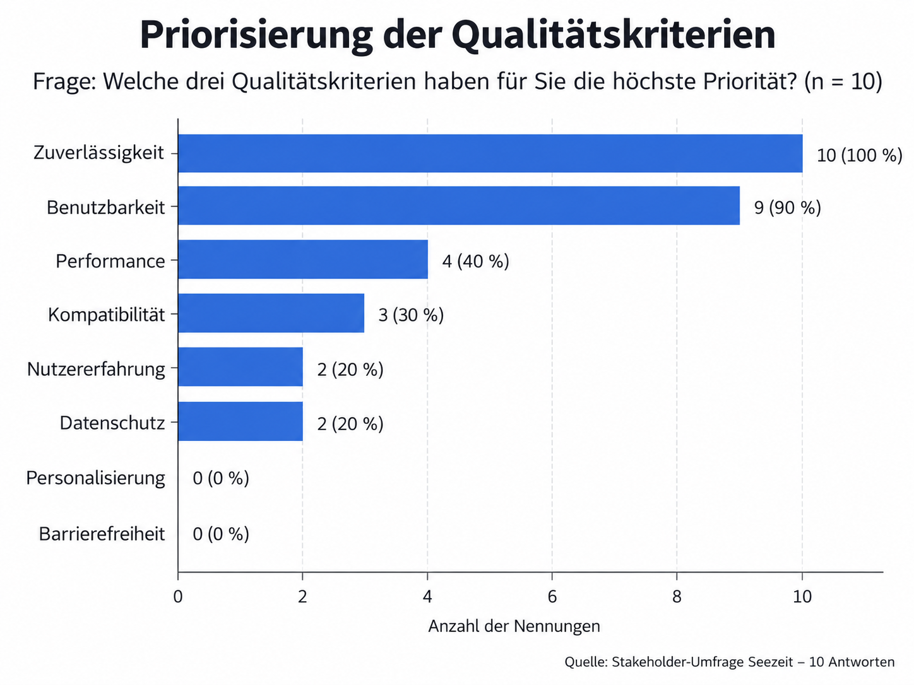

# Qualität

## Alle Qualitätsszenarien mit Priorisierung
 

| **Prio** | **Qualität** | **Leitfrage** | **Auslöser** | **Reaktion** | **Messbares Maß** |
|-|-|-|-|-|-|
| **2** | **Benutzbarkeit** | Ist die App einfach zu bedienen? | Neue:r WG-Bewohner:in öffnet die App zum ersten Mal, um die Checkliste vor der Kontrolle anzuschauen. | Termin, offene Aufgaben und Checkliste werden verständlich angezeigt. | 90 % finden Termin + Checkliste ohne Hilfe in < 2 Min. |
| **6** | **Personalisierung** | Lässt sich die Anwendung an individuelle Bedürfnisse anpassen? | Ein:e Benutzer:in möchte die Benachrichtigungen an seine Bedürfnisse anpassen. | Die Anwendung ermöglicht individuelle Benachrichtigungseinstellungen. | Einstellungen können geändert und gespeichert werden. |
| **1** | **Zuverlässigkeit** | Läuft die App ohne Abstürze und sind die Ergebnisse richtig? | Objektbetreuer:in schließt Kontrolle vor Ort ab, Netz im Treppenhaus/Keller bricht weg. | Ergebnisse und Fotos werden lokal gespeichert und automatisch nachsynchronisiert. | Keine verlorenen Kontrollergebnisse, Sync nach Netz-Rückkehr. |
| **3** | **Performance** | Geht alles schnell genug, ohne lange Wartezeiten? | Objektbetreuer:in fotografiert einen Mangel und lädt das Foto hoch. | Foto wird hochgeladen und ist sofort sichtbar. | Upload in messbar kürzester Zeit. |
| **6** | **Barrierefreiheit** | Können Menschen mit Einschränkungen die App gut nutzen? | Sehbehinderte:r Bewohner:in nutzt Screenreader, um Benachrichtigung und Mängel der WG zu lesen. | Wichtige Informationen werden vorgelesen. | Alle Bedienelemente sind per Screenreader erreichbar. |
| **5** | **Nutzererfahrung** | Ist die Nutzung angenehm und fühlt man sich gut informiert? | Bewohner:in bekommt nach der Kontrolle einen Hinweis, dass ein Mangel festgestellt wurde. | App zeigt Mangel mit Beschreibung, betroffenem Bereich, Foto und Frist bis zur Nachkontrolle auf einen Blick. | Ergebnis nach Abschluss in der App sichtbar, weniger Rückfragen und Diskussionen. |
| **4** | **Kompatibilität** | Funktioniert die WebApp auf Handy, Tablet und Computer? | Mitarbeitende:r kontrolliert mit Tablet oder Handy vor Ort, Sachbearbeitung arbeitet am Büro-PC, Bewohner:in nutzt älteres Android-Handy. | Checkliste und Kamerafunktion laufen auf Mobilgeräten, Layout passt sich an. | Aktuelle Browser, Kamera auf allen unterstützten mobilen Geräten nutzbar. |
| **5** | **Datenschutz** | Sind persönliche Daten sicher und geschützt? | Bewohner:in versucht, Ergebnisse oder Fotos einer fremden WG aufzurufen. | Zugriff wird verweigert und Bewohner:innen sehen nur die eigene WG. | Keine Zugriffe auf fremde WG-Daten, Fotos und Historie DSGVO-konform gelöscht und EU-Server wird genutzt. |
 

## Umfrageergebnisse zu den Qualitätsszenarien
 

### Top 3 Qualitätsszenarien

| **Prio** | **Qualität** | **Auslöser** | **Reaktion** | **Messbares Maß** |
|---|---|---|---|---|
| **1** | **Zuverlässigkeit** | Objektbetreuer:in schließt eine Kontrolle vor Ort ab und die Netzwerkverbindung bricht weg. | Ergebnisse und Fotos werden lokal gespeichert und nach Wiederherstellung der Verbindung automatisch synchronisiert. | Keine Kontrollergebnisse gehen verloren; Synchronisierung erfolgt nach Wiederherstellung der Verbindung. |
| **2** | **Benutzbarkeit** | Neue:r WG-Bewohner:in öffnet die Anwendung zum ersten Mal, um die Checkliste vor der Kontrolle anzusehen. | Termin, offene Aufgaben und Checkliste werden verständlich dargestellt. | 90 % der Nutzer:innen finden Termin und Checkliste ohne Hilfe in unter 2 Minuten. |
| **3** | **Performance** | Objektbetreuer:in fotografiert einen Mangel und lädt das Foto hoch. | Das Foto wird komprimiert hochgeladen und anschließend angezeigt. | Der Upload erfolgt innerhalb einer festgelegten maximalen Zeit. |

## Definition of Ready (DoR) & Definition of Done (DoD)

### DoR
Eine User Story ist bereit für den Sprint, wenn:

1. **Format:** Sie im Format „Als [Nutzerrolle] möchte ich [Funktion/Ziel], damit [Nutzen/Mehrwert]“ formuliert ist.
2. **Einordnung:** Sie eine eindeutige ID hat und einem Epic/Release zugeordnet ist.
3. **Akzeptanzkriterien:** Sie Akzeptanzkriterien enthält und dadurch testbar ist.
4. **Rechte:** Geklärt ist, wer was sehen und bearbeiten darf.
5. **Wireframe/Skizze:** Ein Wireframe oder eine Skizze an der User Story hinterlegt ist (nur bei Stories mit UI-Anteil).
6. **Umfang:** Sie vom Team geschätzt wurde und innerhalb eines Sprints umsetzbar ist.
7. **Abhängigkeiten:** Abhängigkeiten zu anderen Stories bekannt und dokumentiert sind. Die Story ist möglichst unabhängig. Die Feature-Teams wirken bei der Prüfung der technischen Umsetzbarkeit beratend mit.
8. **Fachliche Inhalte:** Alle benötigten fachlichen Inhalte (z. B. Checklisten, Regeln, Abläufe und Beispieldaten) vorliegen.

### DoD

Eine User Story ist fertig umgesetzt, wenn:

1. **Code Review:** Der Code nach dem Vier-Augen-Prinzip geprüft wurde.
2. **Tests:** Tests geschrieben wurden und erfolgreich durchlaufen.
3. **Kompatibilität:** Die Umsetzung auf den vereinbarten Endgeräten und Browsern geprüft wurde.
4. **Datenschutz:** Die festgelegten Datenschutzvorgaben eingehalten wurden.
5. **Main-Branch:** Der Code im Main-Branch integriert und der Build grün ist.
6. **Testumgebung:** Die Anwendung mit der umgesetzten Story auf der Testumgebung läuft.
7. **Dokumentation:** Die relevante Dokumentation aktuell ist.
8. **Abnahme:** Alle Akzeptanzkriterien erfüllt sind und der Product Owner die Story fachlich geprüft und abgenommen hat.
