# Datenmodell

Die JPA-Entities im Backend sind das Schema. Hibernate legt die Tabellen im Profil `dev` per `ddl-auto: create-drop` in einer H2-Datenbank an. Es gibt noch keine Migrationen und keine PostgreSQL-Instanz.

Jedes Modul schreibt nur in die eigenen Tabellen ([ADR-0003](adr/0003-structure-the-backend-as-a-modular-monolith.md)). Fremdschlüssel über Modulgrenzen sind die gemeinsamen Verträge. Dateien selbst liegen im privaten Dateispeicher, in der Datenbank steht nur `attachments` ([ADR-0005](adr/0005-use-postgresql-and-private-attachment-storage.md)).

`users.residence_id` stammt aus dem Template (genau eine Wohnanlage pro Nutzer). Fachlich ersetzen das `memberships` für Bewohnende und `staff_assignments` für Personal. Für die Sachbearbeitung gilt bereits `staff_assignments`, für die Objektbetreuung bei Kontrollen ebenfalls (Betreuung und Vertretung, US-03). `users.user_type` ist die Sicht und einer von `STUDENT`, `CARETAKER` oder `CLERK`. Die Tabelle bleibt eine.

## Überblick

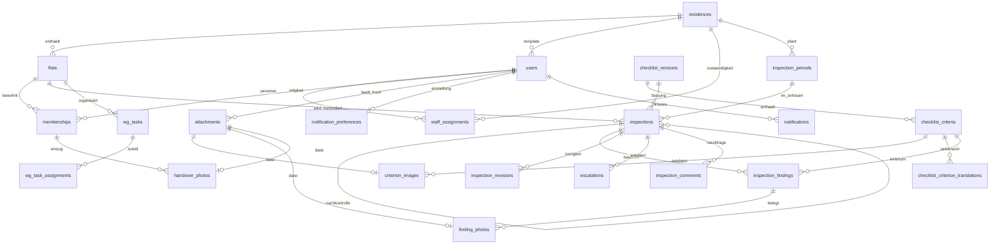

## Identität und Wohnen

Paket `de.seezeit.aume.residence` und `de.seezeit.aume.user`.

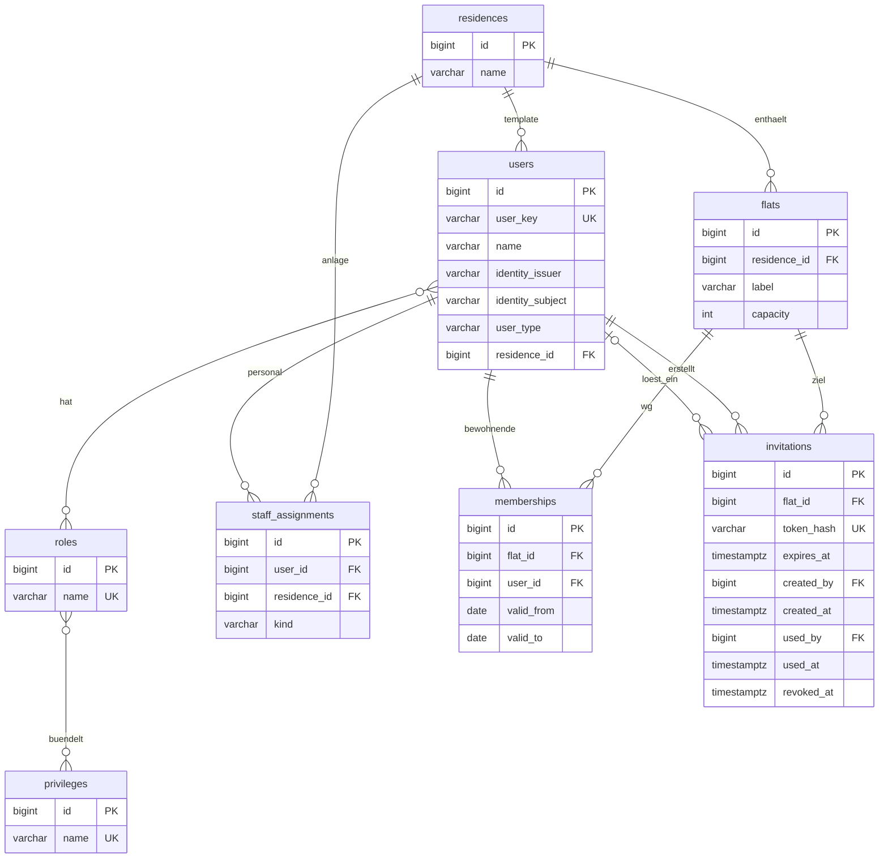

`memberships.valid_to` leer heißt aktuell eingezogen; sonst ist es der erste Tag ohne Zugriff. `invitations` speichert nur den Hash des einmaligen Tokens. `staff_assignments` ist je Nutzer und Wohnanlage eindeutig; eine Person hat pro Anlage also höchstens eine Zuständigkeit. `kind` ist `CARETAKER` (Objektbetreuung), `DEPUTY` (Vertretung, ebenfalls eine Objektbetreuung) oder `CLERK` (Sachbearbeitung). Pro Anlage gibt es höchstens eine Betreuung und eine Vertretung; das sichert der Service, nicht die Datenbank. `users` ist je `(identity_issuer, identity_subject)` eindeutig.

## Anhänge

Paket `de.seezeit.aume.attachment`. `storage_key` verweist auf die Datei im privaten Speicher. Im Profil `dev` liegen die Bytes unter `devdata/uploads`. `POST /api/attachments` und `GET /api/attachments/{id}` sind nur dort registriert; gelesen wird nur die eigene Datei.

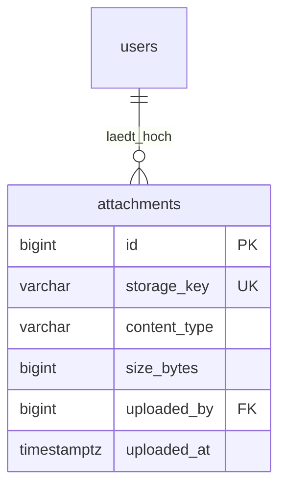

## Standards

Paket `de.seezeit.aume.standard`. Eine veröffentlichte `checklist_versions`-Zeile bleibt unverändert; geänderte Kriterien ergeben eine neue Fassung ([ADR-0007](adr/0007-version-standards-and-preserve-published-inspection-history.md)).

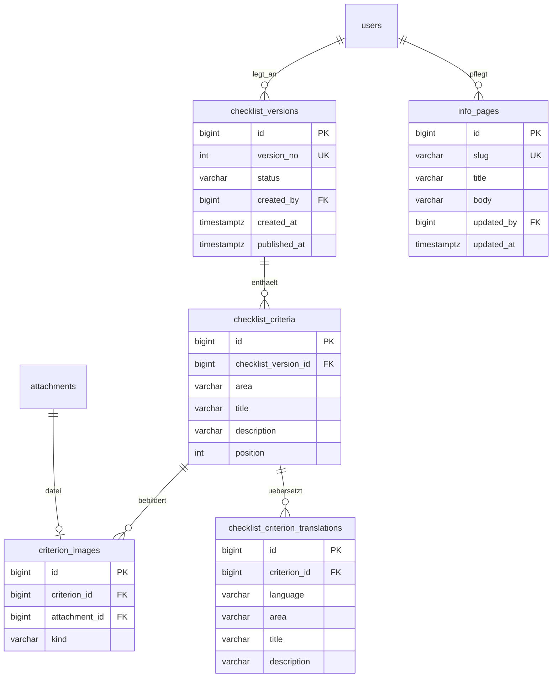

`checklist_versions.status`: `DRAFT`, `PUBLISHED`, `RETIRED`. `criterion_images.kind`: `GOOD`, `BAD`.

`checklist_criteria` enthält die deutsche Fassung. `checklist_criterion_translations` ergänzt je Kriterium und Sprache (`language`, aktuell `en`) Bereich, Titel und Erklärung; `(criterion_id, language)` ist eindeutig. Fehlt eine Übersetzung, liefert die API den deutschen Text.

## Kontrollplanung

Paket `de.seezeit.aume.planning`. Ein Zeitraum gilt für eine Wohnanlage; die Kontrolle je WG liegt bei `inspections`.

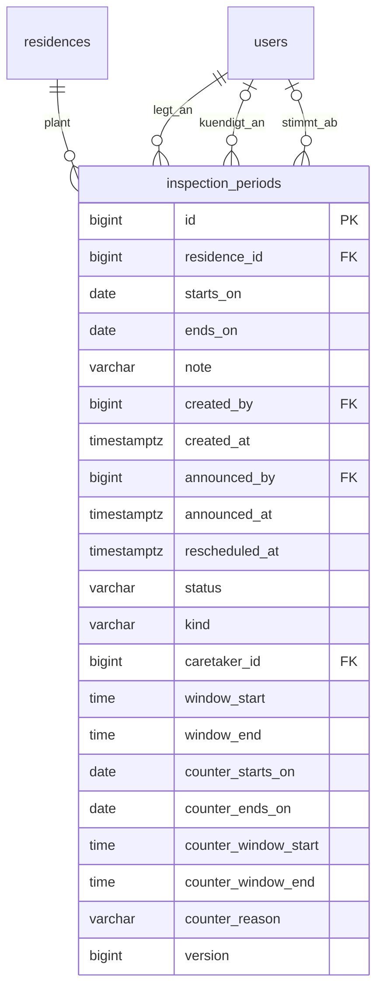

`inspection_periods.status`: `WAITING_FOR_CARETAKER`, `COUNTER_PROPOSED`, `AGREED`. `kind`: `REGULAR`. Angekündigt ist ein Zeitraum, sobald `announced_at` gesetzt ist. `version` ist das Optimistic-Lock-Feld.

`rescheduled_at` ist optional und erfasst den Zeitpunkt der letzten Terminänderung nach der Ankündigung. US-18 setzt ihn in derselben Transaktion wie die neuen Werte, und zwar auch dann, wenn sich nur das Uhrzeitfenster ändert. Sonst bekämen die WGs bei einer reinen Uhrzeitänderung keine Nachricht. Bis einschließlich der Erstankündigung bleibt das Feld leer. Ohne Änderung lehnt die API ab (`period_unchanged`). Der US-15-Lesepfad verwendet das Feld bereits.

`inspection_announcements` ist der Versandeintrag aus US-18: eine Zeile je Ankündigung (`kind = ANNOUNCEMENT`) und je Terminänderung (`RESCHEDULE`). `sent_at` ist gleich dem gesetzten `announced_at` bzw. `rescheduled_at`. Zeitraum, Anzahl der WGs und Text halten den Stand beim Versand fest. `channels` ist kommagetrennt, aktuell nur `IN_APP`. `attachment_id` ist optional und verweist auf eine Datei, die die Sachbearbeitung selbst hochgeladen hat.

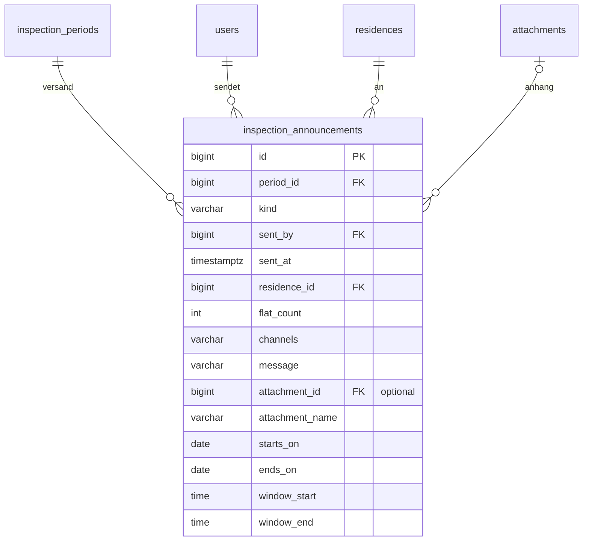

Hibernate legt die Spalte im aktuellen H2-Schema mit `ddl-auto: create-drop` an. Für persistente Installationen braucht es eine abgestimmte Migration, die die nullable Spalte ergänzt und bestehende Zeiträume ohne Änderungsnachweis leer lässt.

## Kontrollen

Paket `de.seezeit.aume.inspection`. Eine Nachkontrolle ist selbst eine `inspections`-Zeile mit `round` 1 oder 2 und `parent_inspection_id`. Das Gesamtergebnis setzt die prüfende Person.

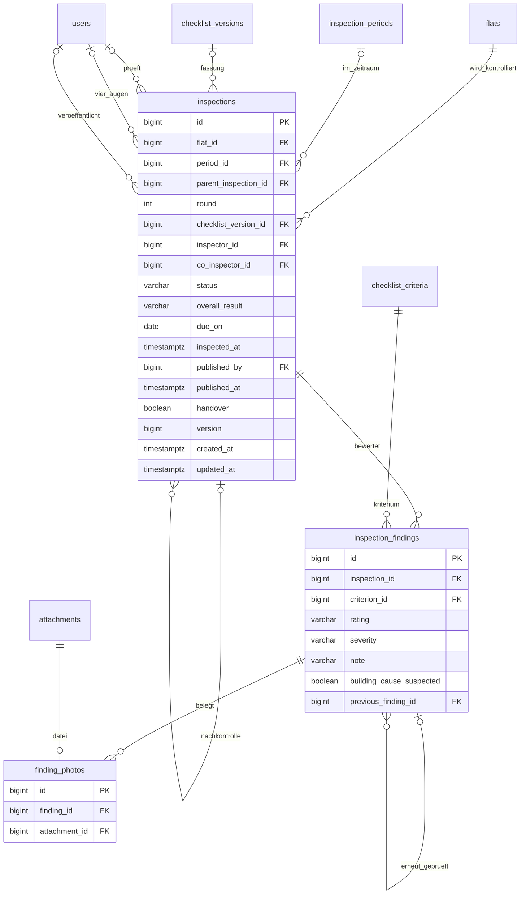

`inspections.status`: `PLANNED`, `DRAFT`, `FINALIZED`, `PUBLISHED`. „Kontrolle abschließen“ durch die Objektbetreuung setzt direkt `PUBLISHED` mit `published_by` = prüfende Person; die WG sieht das Ergebnis sofort (Teamentscheidung 24.11.2026). `FINALIZED` wird derzeit nicht gesetzt. `overall_result`: `PASSED`, `FAILED`. `inspection_findings` ist je Kontrolle und Kriterium eindeutig. `rating`: `OK`, `DEFICIENT`, `RESOLVED_ON_SITE`. `severity` nur bei `DEFICIENT`: `LIGHT`, `SEVERE`. `version` ist das Optimistic-Lock-Feld.

## Ergebnisse und Nachkontrollen

Paket `de.seezeit.aume.result`. Nachkontrollen stehen in `inspections`. Hier liegen Korrekturen, Eskalationen, Rückfragen und Einzugsfotos.

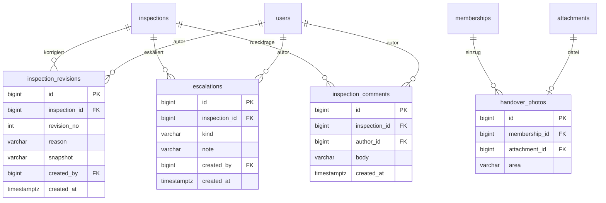

`inspection_revisions` ist je Kontrolle und `revision_no` eindeutig; `snapshot` ist das veröffentlichte Ergebnis als JSON. `escalations.kind`: `CLEANING_COMPANY`, `WARNING`. Der Übergabezustand aus der Kontrolle vor dem Auszug ist `inspections.handover`.

## WG-Organisation

Paket `de.seezeit.aume.wg`. Nur für Mitglieder der WG sichtbar, nicht für Personal und nicht in Auswertungen.

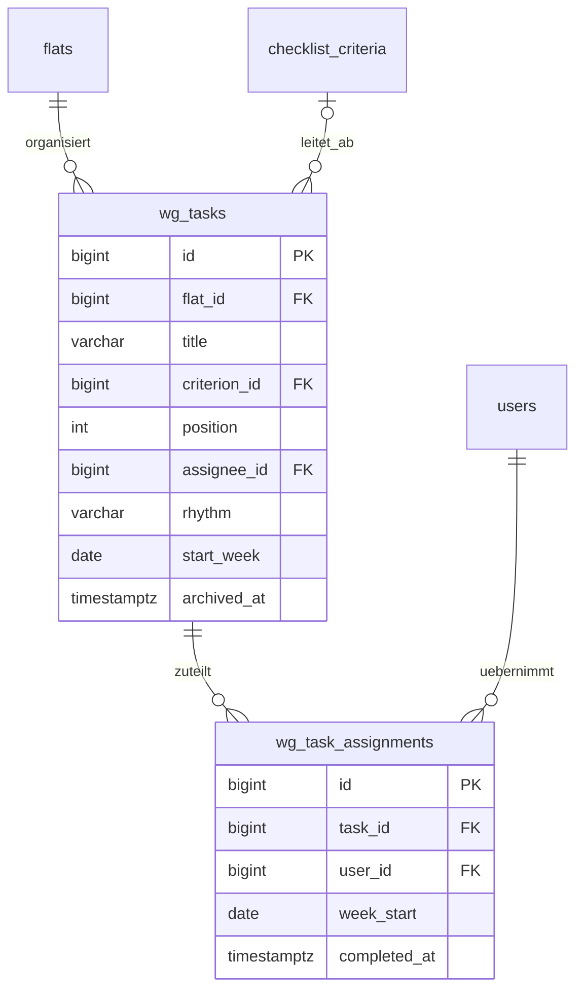

`wg_task_assignments` ist je Aufgabe und Woche eindeutig.

## Benachrichtigungen

Paket `de.seezeit.aume.notification`. `inspection_notifications` enthält den gemeinsamen fachlichen Inhalt. `notifications` enthält die persönlichen Zustellungen mit individuellem Gelesen-Zeitpunkt und kann auch allgemeine Hinweise ohne Kontrollnachricht speichern. Die vorhandenen Präferenzen und die Outbox bleiben unabhängig davon. Der Worker aus [ADR-0008](adr/0008-run-background-work-through-a-transactional-outbox.md) ist ein Architekturvorschlag.

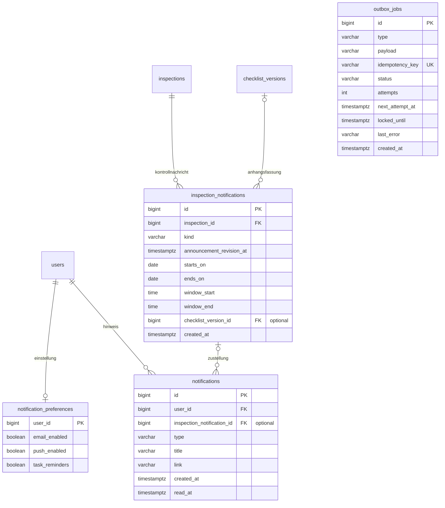

`outbox_jobs.status`: `PENDING`, `DONE`, `FAILED`.

- Eine gemeinsame Nachricht ist je Kontrolle, Ankündigungsrevision und Nachrichtenart eindeutig. Die Arten sind `ANNOUNCEMENT`, `REMINDER_7_DAYS` und `REMINDER_1_DAY`. Pro gemeinsamer Nachricht ist höchstens eine Zustellung je Person möglich.
- Zeitraum und Zeitfenster halten den Stand der Nachricht fest. Ausschließlich Ankündigungen können auf eine Checklistenfassung verweisen. Das PDF wird beim berechtigten Download aus dieser Fassung erzeugt. Referenzierte veröffentlichte Fassungen einschließlich ihrer Kriterien und Übersetzungen müssen für spätere Downloads unverändert erhalten bleiben. Fassungen mit Status `RETIRED` bleiben als Anhang verfügbar. Beide Erinnerungen führen gemäß der abgestimmten Abweichung von US-16 (#20) zur interaktiven Checkliste.
- Die Postfachabfragen für Liste, Einzeleintrag und Ungelesen-Zähler berücksichtigen dieselbe Empfänger-ID und die aktive Mitgliedschaft in der WG der Kontrolle. `validFrom` gilt inklusive, `validTo` exklusiv. Die konkrete Zugriffspolitik beim Wiedereinzug steht aus. Die Abfragen allein würden bei einer erneuten aktiven Mitgliedschaft in derselben WG alte Zustellungen wieder sichtbar machen.
- Die lesende Kontrollquelle liefert angekündigte geplante Kontrollen und Entwürfe mit noch nicht abgelaufenem Zeitraum. Für die aktuelle Revision gilt `announcedAt` oder ein neueres `rescheduledAt`. Der Scheduler verarbeitet ausschließlich die noch gespeicherte offizielle Revision. Zwischen zwei Läufen überschriebene Revisionen werden bewusst nicht rekonstruiert. Bereits gespeicherte Nachrichten behalten ihren Zeitraum. Der Umgang mit Absagen bleibt offen.

## Audit

Paket `de.seezeit.aume.audit`. Auswertungen (Quoten, Mängelmuster) haben keine eigenen Tabellen; sie werden aus `inspections` und `inspection_findings` gelesen.

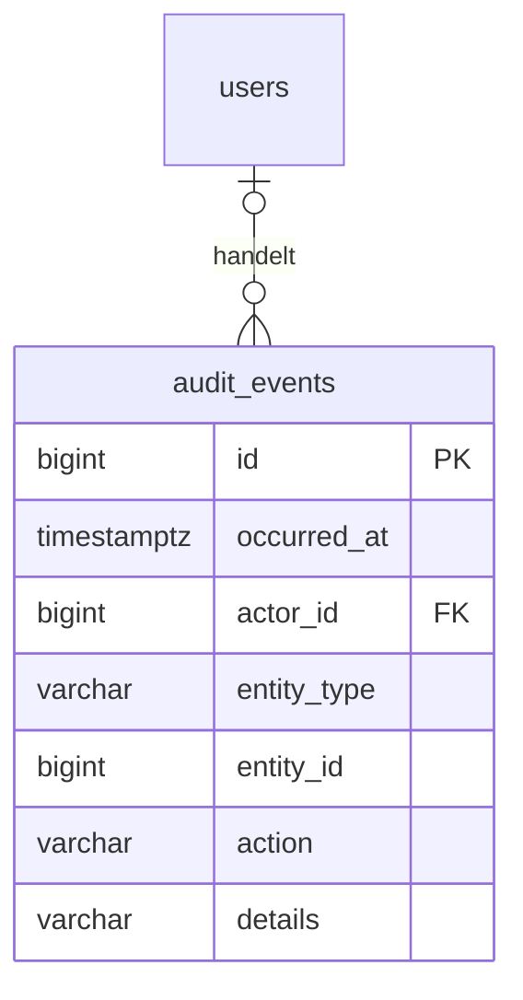
