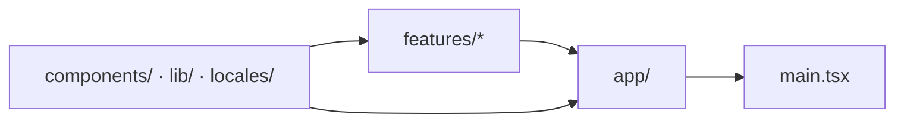

# Frontend-Ordnerstruktur

Dieses Dokument beschreibt, wie der Code unter `frontend/src/` organisiert ist, warum er so organisiert ist und wo neuer Code abgelegt wird. Die Struktur folgt den aktuell verbreiteten Empfehlungen für React-Anwendungen mit Vite und React Router. Sie wurde bewusst nur so weit eingeführt, wie es der heutige Umfang des Frontends erfordert.

Routing, Anmeldung und Loader selbst sind in [frontend/ROUTING.md](../../frontend/ROUTING.md) beschrieben.

## Kurzfassung

- Fachlicher Code liegt **nach Features gruppiert** unter `src/features/<feature>/`. Ein Feature enthält seine Seiten, API-Funktionen, Typen und Routen.
- Code, den **mehrere Features** brauchen, liegt in gemeinsamen Ordnern: `src/components/` für React-Komponenten und `src/lib/` für vorkonfigurierte Bibliotheken und Helfer (Anmeldung, API-Zugriff, Fehler, Sprache).
- `src/app/` setzt die Anwendung zusammen: App-Komponente, Router, Layout, Navigation und Fehlerseiten.
- Abhängigkeiten zeigen nur in eine Richtung: **gemeinsamer Code → Features → App**. Features importieren nicht aus anderen Features. ESLint prüft diese Regeln.
- Ordnerübergreifende Imports nutzen den Alias `@/` (zum Beispiel `@/lib/auth/client`). Innerhalb eines Features oder Ordners wird relativ importiert.

## Recherche und Quellen

Für React gibt es keine offizielle, verbindliche Ordnerstruktur. Die frühere [React-Dokumentation](https://legacy.reactjs.org/docs/faq-structure.html) hat dies ausdrücklich so formuliert und empfohlen, mit einer einfachen Struktur zu beginnen und sie erst bei Bedarf auszubauen. Die heute verbreiteten Empfehlungen stimmen in den Grundzügen überein:

| Quelle | Kernaussagen, die übernommen wurden |
| --- | --- |
| [Robin Wieruch: React Folder Structure](https://www.robinwieruch.de/react-folder-structure/) | Struktur schrittweise mit dem Projekt wachsen lassen. Feature-Ordner für fachlichen Code, technische Ordner (`components/`, `hooks/`, `lib/`, `utils/`) nur für wirklich gemeinsam genutzten Code. Code fließt in eine Richtung; Features importieren nicht voneinander. Etwas wird erst in die gemeinsame Ebene verschoben, wenn ein zweites Feature es benötigt. Absolute Imports über einen Alias. |
| [Bulletproof React: Project Structure](https://github.com/alan2207/bulletproof-react/blob/master/docs/project-structure.md) | Ordner `app/` (Router, Provider, Routen), `features/`, `components/`, `lib/` als gemeinsame Ebene. Gerichtete Abhängigkeiten `shared → features → app`, durch ESLint erzwungen. Keine Barrel-Dateien (`index.ts` mit Re-Exports), weil sie das Tree-Shaking in Vite verschlechtern; stattdessen direkt auf Dateien importieren. Unterordner in einem Feature nur anlegen, wenn sie gebraucht werden. |
| [React Router: Data Mode](https://reactrouter.com/start/data/route-object) | Routen als Objekte mit `loader`, `Component` und `ErrorBoundary`. Ermöglicht, dass jedes Feature seine Routenobjekte selbst exportiert und `app/router.ts` sie nur zusammensetzt. |
| [Feature-Sliced Design](https://feature-sliced.design/) | Geprüft, aber nicht übernommen: Die sieben Schichten (`app`, `pages`, `widgets`, `features`, `entities`, `shared`) und Segmente sind für ein Frontend mit drei Features zu schwergewichtig. Die zentrale Idee gerichteter Schichten steckt bereits in der gewählten Struktur. |

Der Grundsatz „so viel wie nötig, so wenig wie möglich“ entspricht auch der Empfehlung beider Hauptquellen: Ordner wie `hooks/`, `stores/`, `types/`, `utils/` oder `config/` werden erst angelegt, wenn tatsächlich Code dafür existiert.

## Zielstruktur

```text
frontend/src/
  main.tsx                    Einstiegspunkt: Sprache und Keycloak initialisieren, Router erstellen
  index.css                   Globale Basisstile
  app/                        Anwendungsebene: setzt Features und gemeinsamen Code zusammen
    App.tsx                   AuthProvider und RouterProvider verbinden
    App.css                   Stile des Anwendungsrahmens
    App.test.tsx              Routing-Integrationstests über alle Routen
    router.ts                 Routen aller Features registrieren
    navigation.ts             Navigationspunkte zusammenführen
    AppLayout.tsx             Kopfbereich, Navigation, Sprachwahl, Abmelden, Outlet
    RouteErrorLayout.tsx      Layout für Ladefehler
    RequireAuth.tsx           Anmeldung für die geschützte Routengruppe verlangen
    routes/                   Seiten ohne eigenes Feature: Forbidden, NotFound, RouteError
  features/                   Fachliche Features, je ein Ordner
    auth/                     Anmeldeseite und Login-Route
    dashboard/                Übersicht: Seite, API-Funktion, Routen
    residences/               Wohnanlagen: Seite, API-Funktion, Routen, Navigationspunkt
  components/                 Von mehreren Features genutzte React-Komponenten
    LoadingPage.tsx
  lib/                        Gemeinsame, für die Anwendung vorkonfigurierte Infrastruktur
    auth/                     Keycloak/Dev-Login, api(), Sitzung, useAuth(), Loader- und Seitenguards
    errors.ts                 UiError und errorKey()
    i18n.ts                   i18next-Instanz und Sprachauswahl
    i18next.d.ts              Typisierung der Übersetzungsschlüssel
  locales/                    de.json und en.json
  assets/                     Statische Dateien (Bilder, Icons)
```

## Die Ordner im Einzelnen

### `app/` – Anwendungsebene

`app/` ist die oberste Schicht. Sie kennt alle Features und verbindet sie: `router.ts` importiert die Routen-Arrays der Features, `navigation.ts` deren Navigationspunkte, und `AppLayout.tsx` bildet den gemeinsamen Rahmen. Hier liegt nur Code, der die Anwendung **zusammensetzt**; fachliche Logik gehört in ein Feature.

`app/routes/` enthält die Seiten, die zu keinem Feature gehören, sondern zur Anwendung selbst: „Keine Berechtigung“, „Seite nicht gefunden“ und die Fehlerseite für fehlgeschlagene Loader. Diese Bezeichnung folgt Bulletproof React, das Routenkomponenten der Anwendung ebenfalls unter `app/routes/` ablegt.

`RequireAuth.tsx` bleibt in `app/`, weil nur der Router es verwendet. `RequirePrivilege.tsx` liegt dagegen in `lib/auth/`, weil Features es in ihren Routen benötigen (siehe Abhängigkeitsregeln).

`App.test.tsx` liegt neben `App.tsx`, weil es die vollständig zusammengesetzte Anwendung mit allen Routen testet.

### `features/` – fachliche Features

Ein Feature ist ein fachlich zusammenhängender Ausschnitt der Anwendung, typischerweise eine oder mehrere Seiten unter einem gemeinsamen URL-Pfad. Jedes Feature besitzt alles, was nur es selbst braucht:

```text
features/residences/
  ResidencesPage.tsx    Seite (liest Loader-Daten)
  api.ts                API-Funktionen und Antworttypen
  routes.tsx            exportiertes RouteObject-Array und optional ein Navigationspunkt
```

Ein Feature beginnt **flach**. Erst wenn es wächst, werden Unterordner nach technischem Anliegen eingeführt, zum Beispiel:

```text
features/inspections/
  routes.tsx
  api.ts
  types.ts
  components/           mehrere Komponenten, die nur dieses Feature nutzt
  hooks/                Hooks, die nur dieses Feature nutzt
```

Für die Ordnernamen gilt: Ein Feature heißt so wie sein fachlicher Bereich beziehungsweise sein URL-Pfad (`residences` für `/residences`). Damit findet man zu einer URL sofort den Code.

`features/auth/` enthält nur die Anmeldeoberfläche. Die eigentliche Anmeldelogik (Keycloak, Sitzung, `useAuth()`) liegt in `lib/auth/`, weil alle Features sie nutzen; ein Feature `auth` mit dieser Logik würde jedes andere Feature zu einem verbotenen Feature-übergreifenden Import zwingen. Bulletproof React trennt dies genauso (`lib/auth` und `features/auth`).

### `components/` – gemeinsame Komponenten

Hier liegen React-Komponenten, die in **mindestens zwei** Features oder in Feature und App verwendet werden, aktuell nur `LoadingPage`. Komponenten in `components/` sind fachlich neutral: Sie kennen keine Wohnanlagen oder Kontrollen und rufen keine Fach-APIs auf.

### `lib/` – gemeinsame Infrastruktur

`lib/` enthält vorkonfigurierte Bibliotheken und anwendungsweite Infrastruktur, auf die alle Features zugreifen:

- `lib/auth/client.ts`: Keycloak- bzw. Dev-Anmeldung und `api()` für alle Backend-Requests (Token, CSRF, `Accept-Language`).
- `lib/auth/session.ts`, `AuthContext.ts`, `AuthProvider.tsx`: Sitzungszustand und `useAuth()`.
- `lib/auth/loaders.ts`, `RequirePrivilege.tsx`, `response.ts`, `returnTo.ts`: Bausteine, mit denen Features geschützte Routen und API-Aufrufe umsetzen.
- `lib/errors.ts`: übersetzbare Fehler (`UiError`).
- `lib/i18n.ts`: i18next-Instanz und Sprachauswahl.

Die Bezeichnung `lib/` folgt beiden Quellen („pre-configured wrappers around third-party libraries“). Ein separates `utils/` wird erst angelegt, wenn es allgemeine, bibliotheksunabhängige Hilfsfunktionen gibt.

### `locales/` und `assets/`

`locales/` enthält die Sprachdateien. Sie bleiben bewusst auf oberster Ebene, weil jedes Feature Texte darin ergänzt und viele Anleitungen auf diesen Pfad verweisen. `assets/` enthält statische Dateien, die über Imports gebündelt werden.

## Abhängigkeitsregeln



Ein Pfeil bedeutet „darf importiert werden von“. Daraus folgen drei Regeln:

1. **Gemeinsamer Code** (`components/`, `lib/`) importiert weder aus `features/` noch aus `app/`. Sonst wäre er nicht mehr gemeinsam, sondern an ein bestimmtes Feature gebunden.
2. **Features** importieren aus `components/`, `lib/` und `locales/`, aber **nicht aus `app/` und nicht aus anderen Features**. Dadurch lässt sich ein Feature verschieben, umbauen oder löschen, ohne dass andere Features brechen. Wenn zwei Features dasselbe benötigen, wird dieser Teil in `components/` oder `lib/` verschoben. Wenn zwei Features auf einer Seite zusammenspielen sollen, geschieht das in `app/`.
3. **`app/`** darf alles importieren und setzt die Features zusammen.

Die Regeln 1 und 2 prüft `npm run lint` über `no-restricted-imports` in [frontend/eslint.config.js](../../frontend/eslint.config.js). Ein Verstoß, etwa `import … from '@/app/navigation'` in einem Feature, bricht den Lint-Lauf mit einer Erklärung ab. Dafür ist kein zusätzliches ESLint-Plugin nötig.

Ein einfacher Test für saubere Grenzen (nach Robin Wieruch): Wenn man einen Feature-Ordner löscht, dürfen nur `app/router.ts` und gegebenenfalls `app/navigation.ts` Fehler melden.

## Import-Konventionen

- **Ordnerübergreifend über `@/`**: `import { api } from '@/lib/auth/client'`. Der Alias zeigt auf `src/` und ist in `tsconfig.app.json` (`paths`) definiert; Vite übernimmt ihn über `resolve.tsconfigPaths`, Vitest über die Vite-Konfiguration. Pfade bleiben so beim Verschieben einer Datei stabil und lesbar, statt `../../../` zu stapeln.
- **Innerhalb eines Features oder Ordners relativ**: `import { listResidences } from './api'`. Das macht sichtbar, dass die Abhängigkeit innerhalb derselben Einheit bleibt.
- **Keine Barrel-Dateien**: Es gibt keine `index.ts`, die den Inhalt eines Ordners re-exportiert. Imports zeigen direkt auf die Datei. Barrel-Dateien erschweren laut Bulletproof React das Tree-Shaking in Vite und können zu Performance-Problemen führen. Robin Wieruch empfiehlt sie dagegen als „öffentliche API“ eines Ordners; für die aktuelle Größe überwiegt hier der Nachteil, und die Grenze zwischen Features wird ohnehin per ESLint geprüft.

## Benennung

Die bestehenden Namenskonventionen bleiben unverändert, um keine reinen Umbenennungen zu erzeugen:

- Komponenten-Dateien in PascalCase wie die Komponente (`ResidencesPage.tsx`), andere Module in camelCase (`returnTo.ts`, `api.ts`, `routes.tsx`).
- Feature-Ordner in Kleinbuchstaben, benannt wie der fachliche Bereich und der URL-Pfad (`residences`).
- Tests liegen als `*.test.ts(x)` direkt neben dem getesteten Code.

Robin Wieruch und Bulletproof React verwenden kebab-case und Robin Wieruch zusätzlich Feature-Namen im Singular. Beides ist Geschmackssache; entscheidend ist, dass ein Projekt eine Konvention durchgängig verwendet.

## Wohin kommt neuer Code?

| Neuer Code | Ablage |
| --- | --- |
| Neue Fachseite oder neuer fachlicher Bereich | Neues Feature `features/<bereich>/` mit `routes.ts(x)`; in `app/router.ts` registrieren |
| Komponente, Hook, Typ oder Helfer, den nur ein Feature nutzt | In diesem Feature, bei Bedarf in einem Unterordner (`components/`, `hooks/`) |
| Komponente, die ein zweites Feature ebenfalls braucht | Nach `components/` verschieben |
| Hook, Helfer oder Bibliothekskonfiguration, die mehrere Features brauchen | Nach `lib/` verschieben; bei reinen, bibliotheksunabhängigen Funktionen `utils/` anlegen |
| Gemeinsamer Hook ohne Bibliotheksbezug | `hooks/` anlegen |
| Seite ohne fachlichen Bereich (Fehler-, Hinweisseite) | `app/routes/` |
| Layout, Provider, Routenregistrierung | `app/` |
| Texte | `locales/de.json` und `locales/en.json` |

Die Richtung gilt auch umgekehrt: Wird gemeinsamer Code nur noch von einem Feature benutzt, wandert er zurück in dieses Feature.

## Bewusst nicht eingeführt

- **Leere technische Ordner** (`hooks/`, `stores/`, `types/`, `utils/`, `config/`, `testing/`): werden angelegt, sobald es dafür Code gibt.
- **`index.ts` als öffentliche API je Feature**: siehe Import-Konventionen.
- **`domains/`, `packages/`, Monorepo**: Robin Wieruch beschreibt diese Stufen für deutlich größere Anwendungen mit vielen Features oder mehreren Apps. Für ein Frontend dieser Größe wären sie reiner Mehraufwand.
- **Umbenennung auf kebab-case**: siehe Benennung.

## Änderungen gegenüber der vorherigen Struktur

Vorher lag das Frontend bereits teilweise nach Features gegliedert vor. Es gab jedoch drei Schwachstellen: Features importierten aus `app/` und `pages/`, wodurch die Abhängigkeiten in beide Richtungen liefen; gemeinsamer Code (`auth.ts`, `errors.ts`, `i18n.ts`) lag lose im Wurzelordner; und neben der Datei `auth.ts` existierte ein gleichnamiger Ordner `auth/`, sodass `'../auth'` und `'../auth/session'` auf unterschiedliche Orte verwiesen.

| Vorher | Nachher | Grund |
| --- | --- | --- |
| `src/App.tsx`, `App.css`, `App.test.tsx` | `src/app/` | Gehört zur Anwendungsebene |
| `src/auth.ts` | `src/lib/auth/client.ts` | Gemeinsame Infrastruktur; Namenskonflikt mit Ordner `auth/` aufgelöst |
| `src/auth/*` | `src/lib/auth/*` | Wird von allen Features genutzt |
| `src/app/loaders.ts`, `src/app/RequirePrivilege.tsx` | `src/lib/auth/` | Features importierten aus `app/` (Richtung umgekehrt) |
| `src/errors.ts`, `src/i18n.ts`, `src/i18n.test.ts`, `src/i18next.d.ts` | `src/lib/` | Gemeinsame Infrastruktur |
| `src/pages/LoadingPage.tsx` | `src/components/` | Von Features und App genutzt |
| `src/pages/LoginPage.tsx` | `src/features/auth/` mit `routes.ts` | Fachliche Seite wie jede andere Feature-Seite |
| `src/pages/ForbiddenPage.tsx`, `NotFoundPage.tsx`, `RouteErrorPage.tsx` | `src/app/routes/` | Seiten der Anwendung ohne eigenes Feature |
| Relative Imports über Ordnergrenzen | Alias `@/` | Lesbare, verschiebungsstabile Imports |
| – | ESLint-Regel `no-restricted-imports` | Abhängigkeitsrichtung wird automatisch geprüft |

Das Laufzeitverhalten ist unverändert; es wurden nur Dateien verschoben, Imports angepasst und die Login-Route als `authRoutes` aus dem Feature exportiert.

## Checkliste für ein neues Feature

1. Ordner `src/features/<bereich>/` anlegen, flach beginnen: Seite, `api.ts`, `routes.ts(x)`.
2. Für API-Aufrufe `api()` aus `@/lib/auth/client` und `requireOk()` aus `@/lib/auth/response` verwenden, für geschützte Loader `protectedLoader()` aus `@/lib/auth/loaders`.
3. Das Routen-Array in `app/router.ts` und optional den Navigationspunkt in `app/navigation.ts` registrieren.
4. Nichts aus anderen Features importieren. Gemeinsam benötigte Teile nach `components/` oder `lib/` verschieben.
5. Texte in `locales/de.json` und `locales/en.json` ergänzen.
6. `npm run lint`, `npm test` und `npm run build` ausführen.
