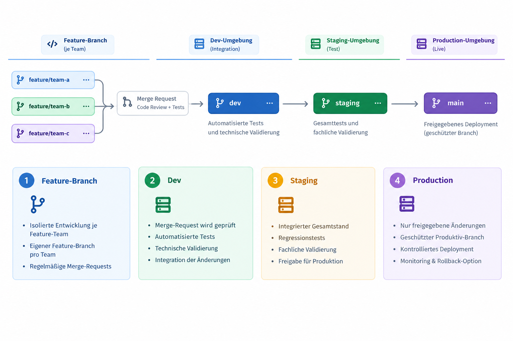

# Prozessmodell

---

## Sprintablauf

- **Dauer:** Zwei Wochen (optional mit interner Abstimmung nach Woche 1 zur frühzeitigen Integration und Vermeidung von Blockaden).
- **Sprintbeginn:**
  - Sprint Planning
  - Definition des Sprintziels
  - Identifikation kritischer Abhängigkeiten
- **Ende Woche 1:**
  - Zieltermin für die Integration abhängiger Stories
  - Transparente Bewertung und Auswirkung ungelöster Blockaden
- **Letzter geplanter Push:**
  - **Zieltermin:** Spätestens einen Tag vor Sprintende
  - **Zweck:** Ausreichend Zeit für Integration, Tests und Fehlerbehebung schaffen.
  - Anschließend Erstellung des Release Branches und Deployment auf Staging durch das Integrationsteam
- **Sprintende:**
  - Sprint Review mit fachlicher Abnahme durch den PO auf Staging
  - Sprint Retrospektive (Bewertung der Ergebnisse & Ableitung konkreter Verbesserungsmaßnahmen)

---

## Methodik und Tools

| **Bereich**             | **Ausprägung / Details**                                                                           |
| ----------------------- | -------------------------------------------------------------------------------------------------- |
| **Framework**           | Scrum (Sprintdauer: 2 Wochen)                                                                      |
| **Tooling**             | **Github**                                                                                         |
| **Arbeitsorganisation** | Gemeinsamer Sprint Backlog mit klarer Festlegung von Zuständigkeiten, Abhängigkeiten und Blockaden |

---

## Meetings & Kommunikation

- **Wöchentliches Abstimmungsmeeting:** Fokus auf Fortschritt, Blockaden, Abhängigkeiten und Entscheidungen. Teilnahme aller betroffenen Teams bzw. deren Vertretungen.
- **Sprint Planning:** Jeweils zu Beginn eines Sprints.
- **Sprint Review:** Alle zwei Wochen am Sprintende.
- **Sprint Retrospektive:** Alle zwei Wochen am Sprintende mit konkreten Maßnahmen für den Folgesprint.

---

## Git Workflow

### Branch Strategie & Teams



- **Feature Branches**
  - Kurzlebiger Branch pro Feature
  - Bezeichnung <Gruppenkürzel>/<Feature-Bezeichnung> bsp: gruppe_1/login
  - Umsetzung durch das zuständige Feature Team
  - Merge nach `develop`, sobald die Story fertig ist

- **Develop Branch**
  - Integration der Feature Branches über Merge Requests (MRs)
  - Gemeinsame Integrations und Testumgebung (Dev Umgebung)
  - Erste Integrationstests
  - Keine fachliche Abnahme auf dieser Stufe

- **Release Branch**
  - Wird nach dem letzten geplanten Push vom Integrationsteam aus `develop` erstellt (z.B. `release/1.4`)
  - Deployment auf die Staging Umgebung
  - Ab Erstellung keine neuen Features, nur Bugfixes
  - Durchführung von Integrationstests und Regressionstests durch das Integrationsteam
  - Fachliche Abnahme der User Stories durch den Product Owner (PO) im Sprint Review (Sprintshow)
  - Bugfixes werden im Release Branch umgesetzt, erneut geprüft und zurück nach `develop` gemergt

- **Production Branch (`main`)**
  - Merge des Release Branches durch das Integrationsteam nach fachlicher und technischer Freigabe
  - Jedes Release wird getaggt (z.B. `v1.4.0`) und dokumentiert
  - Geschützter Branch (`Protected Branch`)
  - Keine direkten Änderungen erlaubt
  - Muss jederzeit eine lauffähige und stabile Version enthalten

### Integration & Qualitätssicherung

1. **Integrationspfad:** `feature/*` ➔ `develop` ➔ `release/*` ➔ `main`

2. **Qualitätsprüfung**
   - Verbindliche Code Reviews vor der Integration
   - Automatisierte Pipeline (Build und Tests) bei jedem MR verpflichtend
   - Technische Gesamtprüfung durch das Integrationsteam auf Staging
   - Fachliche Prüfung und Abnahme durch den PO auf Staging

3. **Integrationsteam**
   - Verantwortung für die teamübergreifende Integration
   - Erstellung der Release Branches und Deployment auf Staging
   - Koordination der Qualitätsprüfung
   - Durchführung und Überwachung der finalen Releaseprüfung
   - Technische Freigabe, Merge nach `main` und Tagging vor der Produktivsetzung
  
## Dokumentation & Artefakte

- **Ablageort:** Alle Projektartefakte liegen im Projekt Repository `AUME2026` im Ordner `/docs`.
- **Format:** Markdown als Quelle, PDFs nur als Export. Diagramme als Mermaid oder Bilddatei im jeweiligen Ordner
- **Änderungen:** Wie Code über Pull Request nach `develop`, Review durch mindestens eine weitere Person
- **Sichtbarkeit:** `develop` ist der Standardbranch des Repositories, damit der aktuelle Stand der Dokumentation sofort sichtbar ist
- **Pipeline:** Pull Requests, die ausschließlich `/docs` ändern, überspringen Build und Tests

### Ordnerstruktur

```
AUME2026/
  CHANGELOG.md                   Änderungen pro Release (Integrationsteam)
  docs/
    projekt/                     Wie arbeiten wir?
      prozessmodell/
      rollen_arbeitsvereinbarung/
    anforderungen/               Was soll das System können?
      fachlich/
        objektbetreuer/
        sachbearbeiter/
        student/
      qualitaet/
    architektur/                 Wie ist das System gebaut?
    features/                    Wie funktionieren die einzelnen Features?
      z.B. login/
```

- Pro Feature ein Ordner unter `features/`, benannt wie der Featureteil des Branchnamens (z.B. Branch `gruppe_1/login` ergibt Ordner `login/`)

### Feature Dokumentation

- Feature Teams dokumentieren ihre Features selbst
- Jeder Pull Request enthält eine kurze Beschreibung (was wurde umgesetzt und warum)
- Die Dokumentation wird im selben Pull Request wie der Code erstellt bzw. aktualisiert
- „Dokumentation aktualisiert“ ist Teil der Definition of Done

### Changelog

- Das Integrationsteam pflegt die `CHANGELOG.md` im Wurzelverzeichnis des Repositories
- Pro Release ein Eintrag mit Version, Sprint und Datum, neueste Version oben
- Gliederung nach: Neu, Geändert, Behoben, Entfernt
