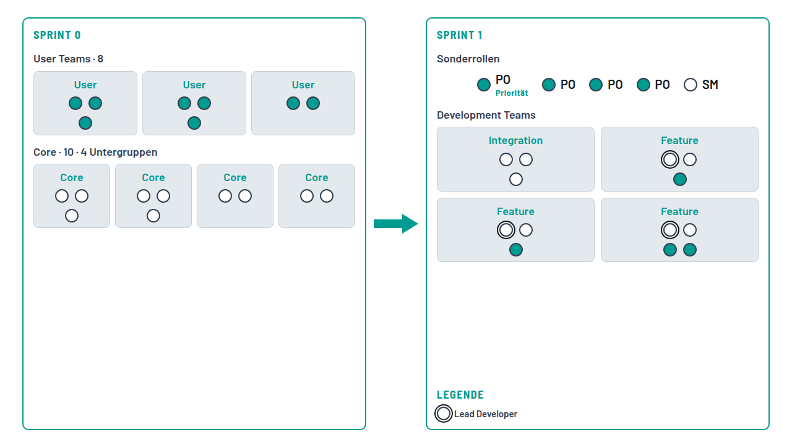

# Rollen und Arbeitsvereinbarung

## Rollen und Verantwortungen

### Product Owner (4)

- Entwickeln nicht.
- ein gemeinsames Backlog

#### PO der Sicht (3)

- Kontakt zu Seezeit für die eigene Sicht
  - Drei Sichten: Studierende, Objektbetreuer, Sachbearbeiter. Je Sicht eine Person.
- Stories, Definition of Ready und fachliche Abnahme der eigenen Sicht
- entscheidet den Inhalt der eigenen Sicht
- entscheidet die Definition of Done der eigenen Story. Die gemeinsame Checkliste gilt für jede Story. Die PO der Sicht kann Kriterien für die eigene Sicht ergänzen.

#### PO Priorität (1)

- keine eigene Sicht
- entscheidet die Priorität des gemeinsamen Backlogs
- entscheidet Konflikte zwischen den Sichten

### Scrum Master / Coach (1)

- moderiert, räumt Impediments aus
- achtet auf die Einhaltung der vereinbarten Prozesse
- hält Termine, Deadlines und den organisatorischen Rahmen sichtbar
- entscheidet nicht über Produkt, Architektur oder den Inhalt der Kontakte
- stimmt bei Uneinigkeit nicht mit

### Entwickler (4 Teams)

#### Integrationsteam (3 Mitglieder)

- Kontakt zu Seezeit-IT und zum Technologiepartner Sybit
  - Anbindung, Zugänge, technische Abstimmung
- Laufzeitumgebungen (Test, Staging, Prod), CI/CD, Tech-Stack und teamübergreifende Architektur
- führt die automatisierten Prüfungen der Definition of Done aus
- kein Merge nach main, keine Architektur des Schnitts
- Sprint 1: Lauffähige Basis - Repository, CI, Deploy auf Test

#### Feature Teams (4, 3, 3)

Alle tragen die Feature-Entwicklung.

- Feature-Entwicklung auf Feature Branches
- liefert den Schnitt selbst: Prüfung der Umsetzbarkeit und Umsetzung
- Merge nach main, sobald die Definition of Done erfüllt ist und der Lead Developer ihn technisch trägt
- Lead Developer:
  - entscheidet den technischen Ansatz des Schnitts
  - entscheidet, ob der Merge nach main technisch trägt
  - spricht für das Team mit dem Product Owner und dem Integrationsteam
  - sitzt für das Team in der wöchentlichen Abstimmung

Die genaue Zuordnung der Aufgaben / Verantwortlichkeiten zu den Rollen steht in der [RACI-Matrix](#raci) am Ende dieses Dokuments.

## Arbeitsvereinbarung

### Kommunikation

Mobile und verteilte Arbeit. Asynchron über Discord-channels, synchron in den Weeklies.

#### Channels

| Kanal                          | Wofür                                                                                                                                                       | Antwortzeit             |
| ------------------------------ | ----------------------------------------------------------------------------------------------------------------------------------------------------------- | ----------------------- |
| Entwicklungs-Channel (general) | Laufende Abstimmung aller Feature Teams, des PO und des Scrum Masters zu Stories, Feature Branches, Reviews, Architektur und Terminen                       | höchstens zwei Werktage |
| Feature-Channel                | Jeweils für die Feature Teams intern                                                                                                                        | höchstens zwei Werktage |
| Integrations-Channel           | Für das Integrationsteam intern                                                                                                                             | höchstens zwei Werktage |
| PO-Channel                     | Abstimmung der POs der Sicht und der PO Priorität, an den drei Sichten orientiert                                                                           | höchstens zwei Werktage |
| Emergency-Channel              | Die VM steht, jemand ist nicht erreichbar (zum Beispiel ein wichtiger offener Merge) oder das Prod-Environment ist nicht erreichbar (zum Beispiel HTTP 500) | am selben Tag           |

#### Weeklies

- Je Feature Team, die Product Owner und das Integrationsteam halten ein Weekly intern.
- Ein gemeinsames Weekly mit mindestens einem Vertreter aller Teams und Gruppen. Themen sind Priorität, Architektur und Blocker. Der Scrum Master ist dabei.

### Abstimmung

- Jede PO der Sicht ist die Schnittstelle zu Seezeit für ihre Sicht (Studierende, Objektbetreuer, Sachbearbeiter). Die PO Priorität priorisiert das gemeinsame Backlog und hat keine eigene Sicht.
- Das Integrationsteam ist die Schnittstelle zu Seezeit-IT und zu Sybit.
- Der Scrum Master hält Termine, Deadlines und den organisatorischen Rahmen sichtbar und achtet auf die Einhaltung der vereinbarten Prozesse. Den Inhalt bestimmen die zuständige PO-Person beziehungsweise das Integrationsteam. Die Termine setzen Seezeit, Seezeit-IT, Sybit und die Veranstalter des Projekts an der Hochschule.

### Uneinigkeit

- Inhalt einer Sicht entscheidet die PO-Person dieser Sicht.
- Priorität und Konflikt zwischen den Sichten entscheidet die PO Priorität.
- Definition of Done einer Story entscheidet die PO der Sicht. Die gemeinsame Checkliste gilt für jede Story. Die PO der Sicht kann Kriterien für die eigene Sicht ergänzen.
- Architektur im Schnitt entscheidet der Lead Developer.
- Teamübergreifende Architektur, Tech-Stack, Umgebungen und CI/CD entscheidet das Integrationsteam.
- Der Scrum Master moderiert und stimmt nicht mit.

## Abschließende Bemerkungen

### Möglicher Übergang zu Sprint 1

- PO der Sicht aus den User Teams. Die PO Priorität in Sprint 1 aus dem User-Anteil eines Feature Teams. Sie entwickelt in Sprint 1 nicht. SM, Integration und Lead Developer aus dem Core Team. Bringen jeweils ihre Expertise mit.
- Ein Feature Team mit zwei Personen aus dem User Team und zwei aus dem Core Team. Zwei Feature Teams mit je einer Person aus dem User Team und zwei aus dem Core Team, darunter der Lead Developer. Befähigt Teams zu vertikalen Schnitt.

### Maßstab

- Neu zusammengesetzte Teams, nicht nur aufgefüllte bestehende.
- Welche Rolle jemand übernimmt, hängt daran, was die Person kann, will und an Verantwortung übernimmt.
- Verantwortung ist nicht Arbeitslast. Die Arbeitslast bleibt gleichmäßig und fair verteilt.

---

## RACI

| Buchstabe       | Bedeutung                              |
| --------------- | -------------------------------------- |
| R - responsible | führt aus                              |
| A - accountable | entscheidet, genau eine Rolle je Zeile |
| C - consulted   | wird gefragt                           |
| I - informed    | wird informiert                        |

Steht in einer Zeile kein R, führt die Rolle mit A die Aufgabe aus.

| Aufgabe                                                      | PO Priorität | PO der Sicht | SM  | Feature-Team der Story | Lead Developer | Integrationsteam |
| ------------------------------------------------------------ | ------------ | ------------ | --- | ---------------------- | -------------- | ---------------- |
| Priorität des gemeinsamen Backlogs                           | A            | C            | I   | I                      | C              | C                |
| Konflikt zwischen den Sichten                                | A            | C            | I   | I                      | I              | I                |
| Definition of Done                                           | I            | A            | I   | C                      | C              | R                |
| Stories einer Sicht                                          | C            | A            | I   | I                      | C              | I                |
| Kontakt zu Seezeit für diese Sicht                           | I            | A            | I   | I                      | I              | I                |
| Produktentscheidung innerhalb der Sicht                      | C            | A            | I   | I                      | C              | I                |
| Definition of Ready                                          | C            | A            | I   | I                      | C              | I                |
| Fachliche Abnahme der erledigten Story nach DoD              | I            | A            | I   | I                      | C              | I                |
| Kontakt zu Seezeit-IT und Sybit                              | I            | I            | I   | I                      | I              | A                |
| Tech-Stack, Umgebungen, CI/CD, teamübergreifende Architektur | C            | I            | I   | I                      | C              | A                |
| Überprüfung der Umsetzbarkeit von Storys nach DoR            | I            | I            | I   | A                      | C              | C                |
| Umsetzung der Stories                                        | I            | I            | I   | A                      | C              | I                |
| Merge nach main                                              | I            | I            | I   | R                      | A              | I                |
| Architektur des eigenen Schnitts                             | C            | I            | I   | C                      | A              | C                |
| Zeitlicher und organisatorischer Rahmen                      | C            | C            | A   | I                      | I              | C                |
| Prozess und Moderation                                       | I            | I            | A   | C                      | C              | I                |

